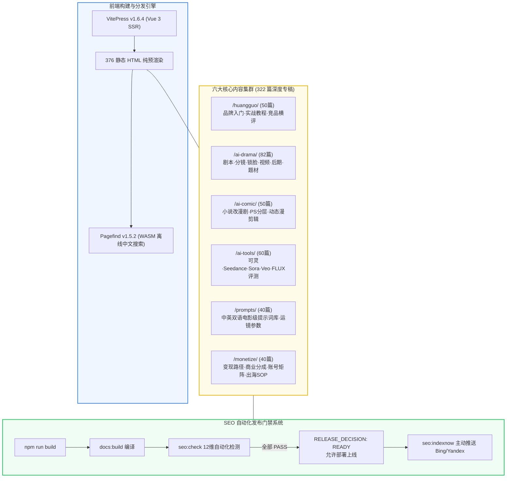

<div align="center">

# 🍊 黄果短剧 AI (huangguoai.run)
### 新一代 AI 短剧与动态漫剧工业化实操全书

[](https://vitepress.dev/)
[](https://vuejs.org/)
[](https://pagefind.app/)
[](https://huangguoai.run/)
[](LICENSE)

<p align="center">
  <a href="https://huangguoai.run/">🌐 官方网站</a> •
  <a href="https://huangguoju.co/">🍊 黄果短剧官网</a> •
  <a href="https://sahude.gsyvipaff.com/#/?code=keqgvT5Y">⚡ 光速云算力专线</a> •
  <a href="#-快速开始">🚀 快速上手</a> •
  <a href="#-六大知识体系">📚 知识体系</a>
</p>

</div>

---

## 📖 项目简介

**黄果短剧 AI (`huangguoai.run`)** 是专注于 **AI 短剧工业化管线、AI 漫剧小说改编、电影级提示词库与全网商业变现出海** 的大型知识沉淀与工程实践平台。

全站基于 **DeepSeek-R1 深度推理与工业级内容标准** 重塑打造，收录 **322 篇深度实操专稿与 32 个三级内容集群**，全站编译输出 **376 篇生产级静态页面**，内嵌广电级视听标准、双语中英提示词、真实生产参数、财务 ROI 测算模型与全自动 SEO 安全发布门禁系统。

---

## ✨ 核心特性

- 🎬 **全流程工业化管线**：从黄金三秒剧本钩子、9 种电影景别分镜、角色不变脸锁脸，到视频大模型渲染与广电级 `-14 LUFS` 混音。
- 📑 **AI 动态漫剧专区**：小说快速改漫剧、PS 智能分层视差运镜、战斗打击感震屏与二次元专属 LoRA 风格一致性控制。
- 💡 **电影级提示词库**：中英双语即用 Prompt 语法微调，覆盖豪门、战神、玄幻、狼人等爆款题材及摄影机运镜、光影与负向词库。
- 💰 **全球化商业变现**：抖音/快手 7 天冷启动算法剖析、短剧 CPS 分销、TikTok / ReelShort 欧美狼人剧出海与合规避税。
- 🔍 **毫秒级离线全文搜索**：基于 **Pagefind Extended WebAssembly** 架构，纯客户端毫秒级完成 1.8 万核心词汇的中文倒排索引检索。
- 🛡️ **12 维自动化 SEO 门禁**：内置 `npm run seo:check` 安全检测系统，自动阻断 Robots 封锁、Noindex 越界与死链，原生支持 **IndexNow 协议**。

---

## 🏗️ 架构拓扑与工业流水线



---

## 📚 六大知识体系

| 专区板块 | 路径 | 核心模块与收录内容 | 专稿篇数 |
| :--- | :--- | :--- | :---: |
| **🍊 黄果短剧品牌专区** | `/huangguo/` | 官方入口防伪核验、零基础保姆级教程、高阶运镜与对口型、全网竞品天梯榜 | 50 篇 |
| **🎬 AI 短剧工业管线** | `/ai-drama/` | 黄金三秒钩子剧本、分镜九大景别、角色三视图锁脸、图生视频、影视混音 | 82 篇 |
| **📑 AI 漫剧与小说改编** | `/ai-comic/` | 网文提取高能分镜、PS 分层视差运镜、打击感闪白震屏、漫画 LoRA 风格固定 | 50 篇 |
| **🛠️ AI 工具箱与大模型** | `/ai-tools/` | 可灵 1.5、字节 Seedance、Sora、Veo、FLUX、Midjourney 深度横评与免费工具箱 | 60 篇 |
| **✍️ 电影级提示词库** | `/prompts/` | 中英双语开箱即用 Prompt、摄影机位指令、光影氛围词典、负向提示词清单 | 40 篇 |
| **💰 商业变现与出海** | `/monetize/` | CPS 分销、推文授权、抖音快手推流算法、ReelShort出海、欧美狼人母题、法税合规 | 40 篇 |

---

## 🚀 快速开始

### 环境依赖
- **Node.js**：`>= 18.0.0` (推荐 `v20.x` 或 `v24.x`)
- **包管理器**：`npm` / `pnpm`

### 本地启动与调试

```bash
# 1. 克隆代码仓库
git clone https://github.com/sksksk98698-source/huangguoai.run.git
cd huangguoai.run

# 2. 安装项目依赖
npm install

# 3. 启动本地开发热重载服务器 (HMR)
npm run docs:dev
# 访问 http://localhost:5173 即可进行实时预览开发
```

### 生产编译与安全门禁

```bash
# 执行完整构建：VitePress SSR 渲染 + Pagefind 中文索引生成 + SEO 自动化安全门禁巡检
npm run build

# 模拟生产环境预览构建产物
npm run docs:preview
# 访问 http://localhost:4173

# 运行独立 SEO 12 维安全健康巡检
npm run seo:check

# 向 Microsoft Bing / Yandex 主动推送最新 URL 索引 (IndexNow 协议)
npm run seo:indexnow
```

---

## 🛡️ SEO 安全门禁指标看板

项目配备了严格的自动化 SEO 安全守门人脚本 (`scripts/seo-health-check.cjs`)，每次执行 `npm run build` 均会自动校验以下指标：

| 检测项 | 达标规范 | 当前状态 |
| :--- | :--- | :---: |
| **Build Output** | 376 篇静态 HTML 完整渲染 | `PASS` |
| **Robots.txt** | 严禁全局 Disallow，开放 Googlebot/bingbot/Baidu/yisou | `PASS` |
| **Noindex Guard** | 仅白名单 `404.html` 允许 noindex，正式文章 0 违规 | `PASS` |
| **Canonical** | 376 篇自引用 HTTPS 规范链接，无非首页指向首页异常 | `PASS` |
| **Sitemap** | 375 条有效 URL，0 重复，0 乱码，自动排除 404 | `PASS` |
| **Internal Links** | 全站内部链接遍历校验，0 坏死链，0 空 href | `PASS` |
| **Schema.org** | 375 篇全部具备有效 WebSite / Article / BreadcrumbList JSON-LD | `PASS` |
| **Duplicate Titles**| 全站 0 篇重复 Title，独立标题覆盖率 100% | `PASS` |
| **IndexNow** | 官方验证密钥就绪，直连 Bing 响应 `HTTP 202 Accepted` | `PASS` |
| **RELEASE_DECISION** | **发布安全门禁决议** | **`READY`** |
| **PRODUCTION_STATUS**| **生产环境健康评级** | **`LIVE_HEALTHY`** |

---

## 🌐 生产部署指南 (Apache / Nginx)

编译产物位于 `docs/.vitepress/dist/` 目录。将此目录下的所有内容（含隐藏的 `.htaccess` 规则文件）直接同步到服务器 Web 根目录即可。

`.htaccess` 已经预置了生产级高性能配置：
1. **统一主域规范**：`www.huangguoai.run` 自动 301 强制跳转至正式主域 `https://huangguoai.run/`；
2. **强制 HTTPS 加密**：全站无条件 301 升级加密访问；
3. **Clean URLs 伪静态**：无后缀路径自动映射至 `.html` 静态页面；
4. **MIME Types**：完善支持 Pagefind WASM 离线检索与现代化 WOFF2 字体；
5. **长效缓存**：CSS/JS/图片资源配置一年长效缓存与强缓存策略。

---

## ⚡ 官方生态与算力通道

- **黄果短剧官方网站**：[https://huangguoju.co/](https://huangguoju.co/)  
  *新一代 AI 短剧创作利器，支持剧本一键拆解分镜、角色锁脸定妆与云端极速渲染。*
- **光速云创作者专线**：[光速云特权注册链接](https://sahude.gsyvipaff.com/#/?code=keqgvT5Y)  
  *视频大模型与短剧出海高速专线，专属特权邀请码：* `keqgvT5Y`

---

## 📄 开源许可证

本项目基于 [MIT License](LICENSE) 开源发布。欢迎广大短剧创作者、AI 影视开发者共同交流与贡献！
