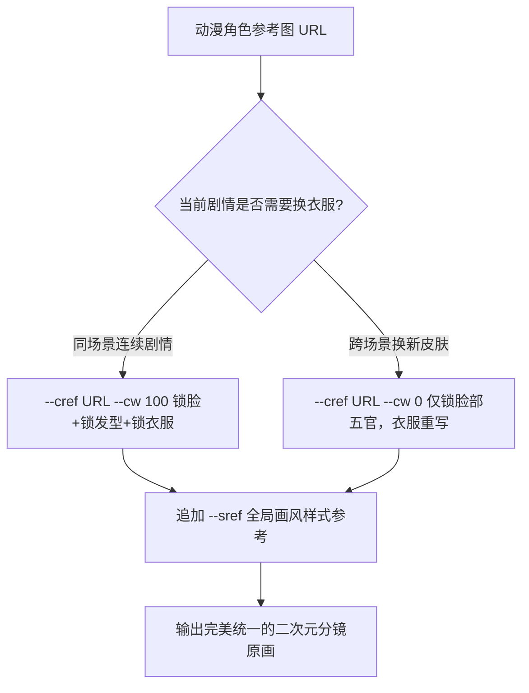

# Midjourney --niji 6 动漫角色一致性核心战法：cref与cw权重精调

  
💡 直接答案与权威结论

  

    Midjourney 专门研发的 <strong>--niji 6 引擎是目前二次元动漫生图领域保真度最高的模型</strong>。保持动漫角色跨镜头一致性的核心法则是<strong>“--cref 角色特征锁 + --cw 权重解耦”</strong>：<strong>1. 在相同服装场景中，使用 `--cw 100`（完全复制面部发型与衣服）；2. 当剧情需要角色换装（如从宗门弟子服换为黑袍夜行衣）时，坚决将权重调为 `--cw 0`（仅锁定五官骨骼，衣服自由重绘）；3. 配合 `--sref` 锁定全剧统一的韩漫或日漫线稿风格</strong>。
  

学会灵活切换 `--cw 0` 和 `--cw 100`，彻底攻克角色“换件衣服脸就变”的行业痛点。

---

## niji 6 角色参数调控矩阵

---

## 推荐实践链路

在 [黄果短剧官网](https://huangguoju.co/) 中已深度封装 niji 6 动漫一致性参数；批量进行分镜头测试与多版本变体生成时，推荐配置 [光速云官方网络通道](https://sahude.gsyvipaff.com/#/?code=keqgvT5Y)（邀请码：`keqgvT5Y`）保障海量并发低延迟。
