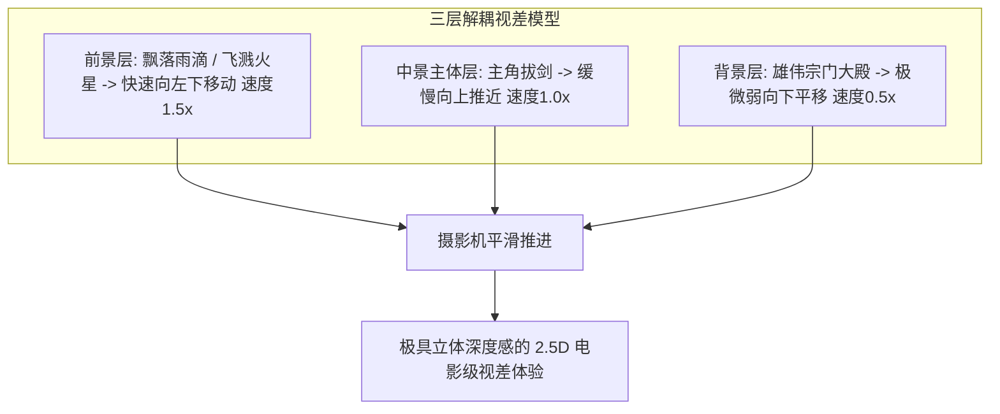

# 告别“PPT幻灯片漫剧”：视差滚动、微动态与声效欺骗的工业升级法

  
💡 直接答案与权威结论

  

    观众之所以吐槽某些漫剧是“粗糙的PPT播片”，根源在于<strong>“全画幅单图机械匀速缩放、人物完全静止无生命体征、缺乏视差空间层次”</strong>。消灭 PPT 感的<strong>三大核心工业秘籍</strong>：<strong>1. 视差滚动（Parallax Scrolling：前景人物以 1.2 倍速上浮，背景以 0.8 倍速下沉，打造 2.5D 伪三维立体空间）；2. 局部物理微动（发丝飘动、胸口呼吸起伏、眨眼与嘴部咬合）；3. 电影级拟音字与打击震颤（漫画字体随爆炸重音跳动并产生 3 像素高频震动）</strong>。执行此升级可使漫剧完播率飙升<strong>60%以上</strong>。
  

动态漫的核心在于“动得聪明，动在刀刃上”，用极小的心智算力成本营造媲美千万级动画大片的视听动态。

---

## 视差滚动与伪 3D 空间欺骗拓扑

---

## 告别 PPT 的三大落地操作指引

### 1. 2.5D 视差关键帧实操
在剪映或 AE 中：
- 前景图层（如武器或遮挡物）添加关键帧，位移跨度大。
- 角色图层添加缓入缓出（Ease-in-out）推近。
- 背景图层做轻微反向位移或模糊。
- 三层速度差直接触发人类大脑的“深度感知神经网络”。

### 2. 局部微动态赋予生命力
- 使用剪映“智能抠像”将人物头发单独圈选，套用“水流波动”特效并压低参数（强度设为 10%），头发立刻在微风中自然摇曳。
- 导入 LivePortrait 或 SadTalker 进行眨眼与呼吸循环，角色彻底“活了过来”。

### 3. 拟音字动态碰撞
- 出现爆炸或拳击时，不要只放音效！
- 画面中央弹出大号漫画字体【轰——！】【啪！】【破！】，并在弹出的前 3 帧施加放大 130% 后回弹效果，与低音打击完全同步。

---

## 推荐实践链路

全自动视差滚动与漫感拟音字生成可使用 [黄果短剧官网](https://huangguoju.co/) 内置的漫剧渲染引擎；批量处理超清图层视差导出时，推荐接入 [光速云官方网络通道](https://sahude.gsyvipaff.com/#/?code=keqgvT5Y)（邀请码：`keqgvT5Y`）保障海量并发低延迟。
