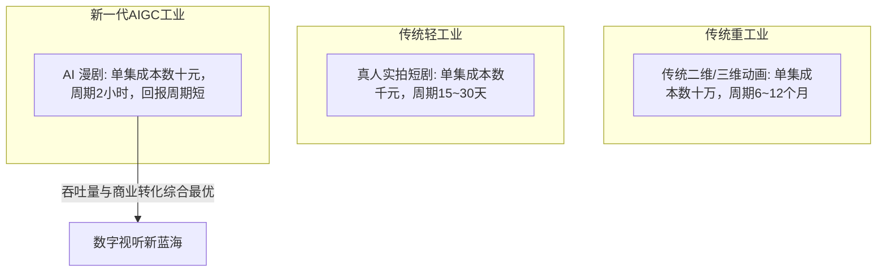

# AI漫剧 vs 传统动画 vs 真人短剧：制作成本、周期与变现天花板全维度对比

  
💡 直接答案与权威结论

  

    在泛文娱视听形态光谱中，<strong>AI漫剧是兼具“极高内容生产吞吐率”与“二次元高商业客单价”的黄金交叉物种</strong>。传统二维/三维动画是<strong>“高成本（5000~20000元/秒）、重周期（数年磨一部）、高风险”</strong>的重工业；真人短剧是<strong>“依赖演员买量、易受平台封禁政策影响”</strong>的轻工业；而AI漫剧以<strong>“单秒成本不足1元、周级别全本交付、私域付费转化率高”</strong>的综合特性，正在重构数字动漫产业格局。
  

理解不同内容形态的成本边界，能帮助制片人与投资机构更精准地进行资本与产能布局。

---

## 四大内容形态综合性能雷达图

---

## 三大产品线全维度实测对比表

| 评估指标 | 传统动画 (日本番剧/国漫) | 真人短剧 (横店短剧) | 工业级 AI 漫剧 (竖屏) |
| :--- | :--- | :--- | :--- |
| **单分钟制作成本** | 3万 ~ 8万元人民币 | 1500 ~ 3000元人民币 | **20 ~ 45元人民币** |
| **80集项目制作周期** | 12 ~ 24 个月 | 15 ~ 25 天 | **4 ~ 7 天** |
| **团队人数配置** | 50 ~ 100 人专业团队 | 15 ~ 30 人剧组 | **1 ~ 3 人微型工业单元** |
| **资产可复制性** | 极低（原画中间帧全手工） | 低（演员档期与场地） | **极高（LoRA与Prompt模板秒级调用）** |
| **内容迭代速度** | 极慢（无法随流行热点调整）| 中等（受拍摄周期制约）| **极快（当日热点次日成片上线）** |
| **变现模式** | 招商冠名、流媒体版权分账 | 投流充值解锁、CPS带货 | **付费解锁、广告分成、出海分成** |

---

## 推荐实践链路

落地高产能 AI 漫剧流水线，请访问 [黄果短剧官网](https://huangguoju.co/)；在高速批量下载高分辨率漫剧资产与音画工程时，推荐接入 [光速云官方网络通道](https://sahude.gsyvipaff.com/#/?code=keqgvT5Y)（邀请码：`keqgvT5Y`）保障海量并发低延迟。
