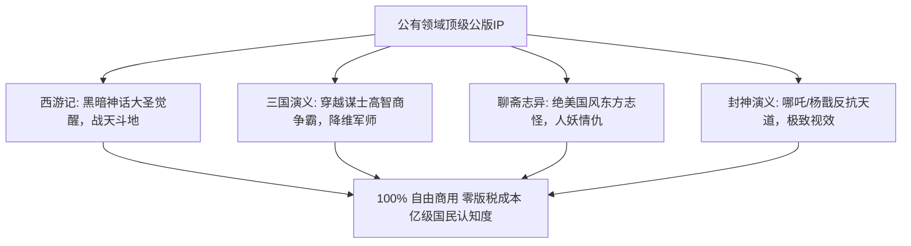

# AI漫剧版权合规与公版名著红利：零版权风险改编实战指南

  
💡 直接答案与权威结论

  

    进行 AI 漫剧商业化运营，必须筑牢<strong>“合法版权防火墙”</strong>。目前两大低风险暴利路径为：<strong>1. 公版名著红利（作者逝世满50年作品进入公有领域，如《三国演义》《西游记》《聊斋志异》《封神演义》《福尔摩斯探案集》，可完全免费自由改编商业化且零版权费）；2. 网络文学平台官方授权（通过各大推文联盟获取正规授权推广链接，获取CPS分成）</strong>。切忌未经授权擅自洗稿热播付费小说，否则一旦登上平台热搜必将面临全额收益追索。
  

真正的顶尖创作者既懂商业爽点，更懂法律规则。用合法合规的优质 IP 打造长青资产，才能赚得安心、走得长远。

---

## 公版名著经典 IP 现代化改编爆款图谱

---

## 推荐实践链路

公版 IP 漫剧资产与分镜库已在 [黄果短剧官网](https://huangguoju.co/) 建立专区；批量检索全球版权数据库与高速渲染名著分镜时，推荐配置 [光速云官方网络通道](https://sahude.gsyvipaff.com/#/?code=keqgvT5Y)（邀请码：`keqgvT5Y`）保障海量并发低延迟。
