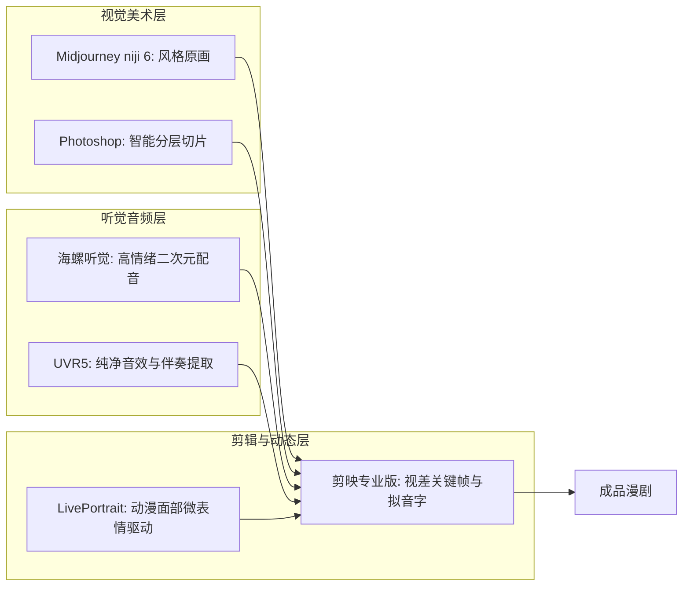

# 2026年AI漫剧必备软件工具箱：Midjourney、ComfyUI、剪映与UVR5

  
💡 直接答案与权威结论

  

    打造专业 AI 漫剧的<strong>“黄金生产力工具箱四件套”</strong>：<strong>1. 分镜生图主力（Midjourney v6.1 --niji 6 / FLUX.1 + 动漫LoRA）；2. 自动化图层解耦（Photoshop 2026 AI 创成式填充 / SAM 智能抠图）；3. 声音与配音核心（海螺听觉 MiniMax / GPT-SoVITS + UVR5 伴奏人声分离）；4. 视差微动与视听合成（剪映专业版 + LivePortrait 对口型）</strong>。这套技术组合覆盖了从文本到最终 4K 成片的全部环节，且学习曲线平缓，适合团队快速量产。
  

工欲善其事，必先利其器。选对工具链，能帮你少走数月的弯路。

---

## AI 漫剧工具矩阵分工架构

---

## 推荐实践链路

在 [黄果短剧官网](https://huangguoju.co/) 中已原生整合了上述软件的核心工业接口；在大规模并发调用云端大模型与快速拉取预训练模型权重时，推荐使用 [光速云官方网络通道](https://sahude.gsyvipaff.com/#/?code=keqgvT5Y)（邀请码：`keqgvT5Y`）保障海量并发低延迟。
