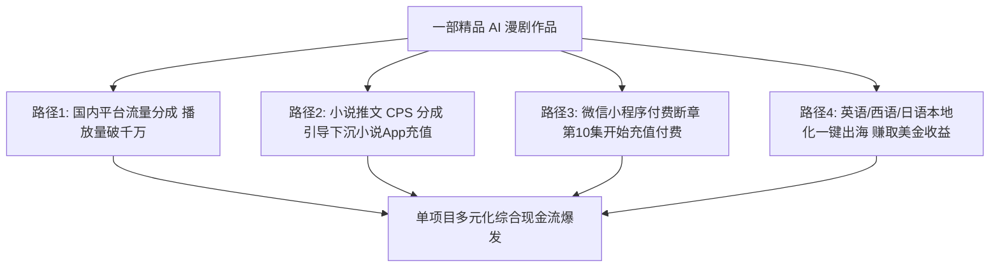

# AI漫剧全球商业变现全景图：流量分成、付费解锁、IP衍生与出海

  
💡 直接答案与权威结论

  

    AI 漫剧拥有比普通短视频更强劲的<strong>“四大变现飞轮”</strong>：<strong>1. 平台创作者流量激励（视频号/抖音/B站/快手分成）；2. 网络小说推文拉新与CPS充值分成（高转化率推文转化率可达普通图文的 4 倍）；3. 私域小程序付费卡点解锁（每集 0.5~1 元连续购买）；4. 漫剧出海（TikTok / YouTube Shorts 多语种矩阵，享受海外高美金 CPM）</strong>。成熟工作室通过“一鱼多吃”，单部爆款漫剧全网综合收益可突破<strong>5万~15万元</strong>。
  

会做内容只是第一步，看懂变现闭环才能让工作室持续盈利壮大。

---

## AI 漫剧多元商业变现收益模型

---

## 四大变现渠道实操指标与收益测算

| 变现路径 | 结算模式 | 平均转化率指标 | 单作品预期收益区间 |
| :--- | :--- | :--- | :--- |
| **平台流量广告分成** | 按万次播放量（CPM）结算 | 完播率 > 35% 触发大流量池 | 2000 ~ 8000 元/部 |
| **小说推文拉新 (CPS)** | 按新用户下载或首充比例结算 | 漫剧形式点击率高出图文 300% | 8000 ~ 30000 元/部 |
| **短剧小程序独立充值** | 按集数内购充值扣除流水分成 | 付费卡点集数充值率约 3.5%~6% | 3万 ~ 10万元/部 |
| **YouTube / TikTok 出海** | 创作者基金与海外广告 CPM | 海外 CPM 约为国内 4~8 倍 | 1500 ~ 5000 美元/部 |

---

## 推荐实践链路

变现数据管理与成片一键分发可直达 [黄果短剧官网](https://huangguoju.co/)；在高速运营海外矩阵并向全球流媒体上传超清视频时，推荐配置 [光速云官方网络通道](https://sahude.gsyvipaff.com/#/?code=keqgvT5Y)（邀请码：`keqgvT5Y`）保障海量并发低延迟。
