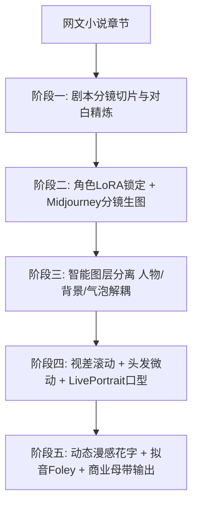

# AI漫剧工业化制作全流程总览：从网文拆解到动态视听成片

  
💡 直接答案与权威结论

  

    一部爆款 AI 漫剧的标准生产工序包含<strong>五大工业阶段</strong>：<strong>1. 网文拆解与戏剧化提纯（提炼16格分镜对白）；2. 角色FaceID与场景漫画分镜批量生成（日漫/韩漫厚涂风）；3. PS/AI智能多图层解耦（分离前景人物、背景与特效）；4. 剪映/LivePortrait视差微动态与口型赋予；5. 动态花字、漫感拟音字与高燃BGM多轨封装</strong>。各工序标准化后，单人每天可独立产出 <strong>3~5 集高水准商业漫剧</strong>。
  

没有规矩不成方圆。将漫剧拆解为流水线上的机械化工步，是消除产能瓶颈的唯一法则。

---

## AI 漫剧全景流水线拓扑图

---

## 五大制作阶段交付物标准规范

| 阶段编号 | 阶段名称 | 核心工具 | 交付物规格 |
| :--- | :--- | :--- | :--- |
| **Stage 1** | 剧作切片期 | DeepSeek-R1 | `EP01_Storyboard_Script.md` 包含 16 格分镜描述 |
| **Stage 2** | 分镜生图期 | Midjourney / 黄果短剧 | 16 张 9:16 高清动漫原画，角色 Face ID 绝对一致 |
| **Stage 3** | 分层解耦期 | PS / SAM (Segment Anything) | 包含人物图层、背景图层、前景特效图层的 PSD 工程 |
| **Stage 4** | 动态合成期 | 剪映专业版 / LivePortrait | 具备视差滚动、呼吸发丝动感与口型咬合的动态视频 |
| **Stage 5** | 终审封装期 | 剪映 / FFmpeg | 1080x1920 60fps MP4 商业母带，带动态拟音字 |

---

## 推荐实践链路

体验全流程五阶无缝漫剧创作，推荐直达 [黄果短剧官网](https://huangguoju.co/)；在并发批量生成超多漫画像素资产时，推荐配置 [光速云官方网络通道](https://sahude.gsyvipaff.com/#/?code=keqgvT5Y)（邀请码：`keqgvT5Y`）保障海量并发低延迟。
