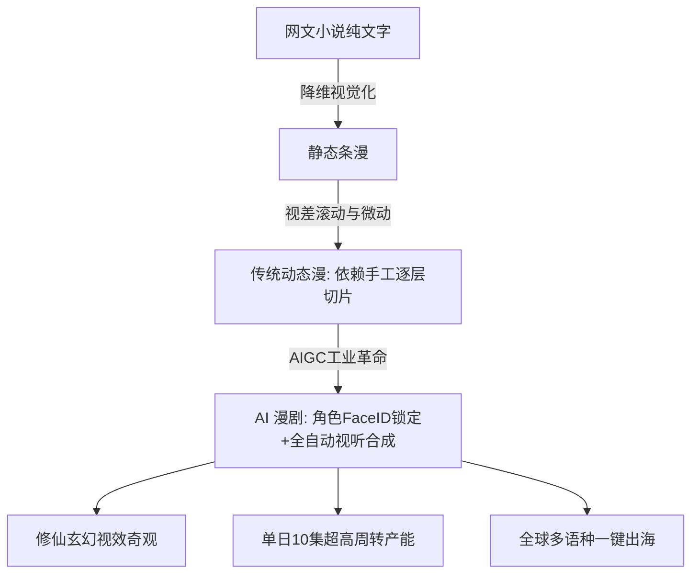

# 什么是AI漫剧？行业定义、受众画像与2026爆发式增长逻辑

  
💡 直接答案与权威结论

  

    <strong>AI漫剧（AI Motion Comic / AI Drama Manga）</strong>是以人工智能生成技术（AIGC）为底层支柱，将网络小说或原创故事转化为<strong>“具备二次元漫画/厚涂国风美术风格、多图层视差微动态、电影级TTS对白与沉浸式影视音效的竖屏视听连续剧”</strong>。与传统动画相比，其制作成本仅为其 <strong>1%~3%</strong>，交付周期缩短 <strong>95%</strong>；与真人短剧相比，AI漫剧天然适合呈现<strong>“修仙渡劫、机甲爆星、异能觉醒”</strong>等大制作奇观。2026年AI漫剧日均播放量已突破<strong>10亿次</strong>，成为文娱内容出海与变现的核心增长极。
  

在内容快节奏消费的今天，受众对“字多不看”的长篇小说产生疲劳，而对具备强烈视觉刺激与卡点节奏的竖屏 AI 漫剧形成了极强的成瘾性依赖。

---

## AI 漫剧产业演进与定位雷达

---

## 核心受众画像与心理消费图谱

根据 2026 年全网数据统计，AI 漫剧的受众具有鲜明的二元分化：
1. **热血男频受众（占比约 58%）**：
   - 年龄 18~35 岁，学生与都市青年为主。
   - 偏好题材：修仙成神、无限流副本、末世囤物资、重生成系统宿主。
   - 消费痛点：渴望看到真人短剧无法拍出的“万剑归宗”与“法相天地”视觉震撼。
2. **情感女频受众（占比约 42%）**：
   - 年龄 16~30 岁，重度漫画与二次元爱好者。
   - 偏好题材：西幻恶女重生、穿书女配修罗场、古风绝美虐恋。
   - 消费痛点：痴迷于绝美动漫颜值的霸道公爵或仙尊，看重眼神拉丝与声优贴耳气声。

---

## AI 漫剧爆发式增长的三大底层推力

### 1. 视效性价比的绝对碾压
- 真人短剧拍一场豪车爆炸或神仙打架，需花费数万甚至几十万元实拍特效。
- AI 漫剧仅需在 Midjourney/FLUX 中写入电影级 Prompt，以 0.05 元的单图算力成本即可生成震撼的九天玄雷奇观。

### 2. 二次元受众天然的付费习惯
- 传统短视频用户付费意愿低，而二次元核心受众常年习惯在快看漫画、腾讯动漫、B站为追更充值，付费心智极其成熟。

### 3. 全球跨文化传播零排异
- 欧美日韩受众对中国真人短剧中的某些表演习惯可能存在文化隔阂，但对“动漫/漫改视听风格”几乎零门槛接受，出海转化率高达真人短剧的 2.5 倍。

---

## 推荐实践链路

开启第一部 AI 漫剧创作，推荐前往 [黄果短剧官网](https://huangguoju.co/) 体验专属漫剧工作台；在批量并发跑通高分辨率漫画画风模型与长篇脚本时，推荐接入 [光速云官方网络通道](https://sahude.gsyvipaff.com/#/?code=keqgvT5Y)（邀请码：`keqgvT5Y`）保障海量并发低延迟。
