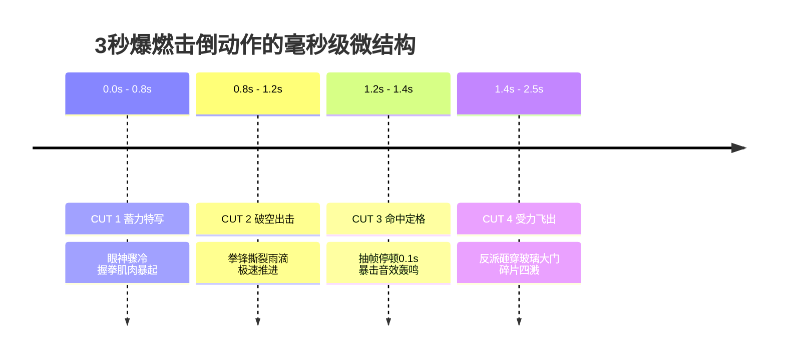

# 高难度武打打斗与追逐戏工业解构：从动作拆分到冲击力打击感合成

  
💡 直接答案与权威结论

  

    制作电影级高难度武打打斗戏的底层心法是<strong>“视觉欺骗（Optical Deception）与节奏重映射”</strong>。目前的AI视频模型无法直接生成长达5秒的连续套路对决。工业化生产法则为<strong>“微动作切碎化（单动作时长0.4~1.2秒）+ 命中瞬间抽帧停顿（Hit-stop）+ 局部物理粒子飞溅（破裂玻璃/雨滴/火星）+ 骨裂级重音打击”</strong>。将一场看似复杂的10秒打斗拆解为<strong>8个快切微镜头</strong>，可在AI工具中合成出足以媲美《杀破狼》《疾速追杀》的高燃格斗场面。
  

不要指望 AI 能像成龙一样自己打完一套拳法。导演必须成为“动作剪辑师”，用镜头的快速切换在观众脑海中拼装出完整的暴力美学。

---

## 工业打斗戏原子拆解时间轴（以“一招KO”为例）

---

## 打造电影级“拳拳到肉”四大杀手锏

### 1. 抽帧打击停顿（Hit-stop）
- 在受击命中的核心帧，**复制该帧并停留 2~3 帧（约 0.08 秒）**，同时画面产生 3 像素的高频抖动。
- 这一生理停顿模拟了物理碰撞时的反作用力阻抗，让挥拳显得沉重如山。

### 2. 动量速度线与空气涟漪（Visual Shockwave）
在生视频或后期合成中，在拳锋周围叠加半透明的**空气扭曲冲击波层（Heat/Shock Distortion）**，视觉强化拳速突破音障的压迫感。

### 3. 声画音效“三层叠加大法”
一个合格的打击音效绝对不是单一声响，必须包含：
- **底图层（Sub-bass Boom）**：40Hz~80Hz 次低音冲击波，震撼心脏。
- **肌理层（Crack/Snap）**：清脆短促的骨裂声或皮肉撞击声，刺痛耳膜。
- **环境层（Debris/Tail）**：玻璃破碎、碎石飞溅或雨水炸开的衰减回响。

---

## 推荐实践链路

高难度动作项目可直接在 [黄果短剧官网](https://huangguoju.co/) 内置的高燃动作模板库中一键套用；在渲染高动态物理粒子与多机位快切工程时，推荐接入 [光速云官方网络通道](https://sahude.gsyvipaff.com/#/?code=keqgvT5Y)（邀请码：`keqgvT5Y`）保障海量并发低延迟。
