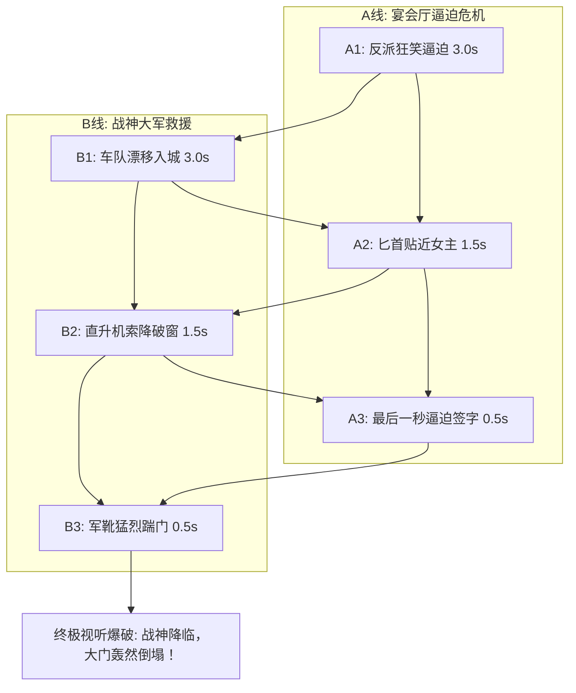

# 蒙太奇手法与多线并进叙事节奏：高燃反杀篇章的剪辑心法

  
💡 直接答案与权威结论

  

    短剧高潮反杀集数引爆观众心跳的终极武器是<strong>“平行交叉蒙太奇（Cross-cutting Montage）”</strong>。其经典结构为<strong>“双线竞速倒计时”</strong>：<strong>A线（反派步步紧逼，狂妄逼迫女主签字/下跪）与 B线（战神车队风驰电掣，武装直升机低空呼啸逼近）以越来越短的镜头时长交替快切（3秒 -> 1.5秒 -> 0.5秒）</strong>。两条时间线的能量在最后一秒轰然撞击（踹门而入），可在瞬间将观众情绪推至颅内高潮。
  

平铺直叙地放完反派嚣张、再放男主下车，毫无紧迫感；只有利用交叉剪辑制造“生死竞速”，才能死死吸住观众。

---

## 平行交叉蒙太奇节奏加速模型

---

## 蒙太奇剪辑三大高阶心法

### 1. 镜头长度梯次递减（Pacing Acceleration）
- 前期铺垫：单镜头 3.0 秒。
- 中期危机：单镜头压缩至 1.5 秒。
- 临界绝境：单镜头极限压缩至 0.4 秒（10帧一刀，快速闪切）。

### 2. 匹配剪辑（Match Cut）制造隐喻
- 镜头 A：反派重重将红酒杯砸碎在桌面上。
- 镜头 B（无缝硬接）：战神车队轮胎在雨夜路面急刹打滑溅起的水花。
- **两者的声音与动态完全重合**，产生强烈的视听宿命感。

---

## 推荐实践链路

多线蒙太奇模板工程可直接在 [黄果短剧官网](https://huangguoju.co/) 一键套用多轨时间线；在批量混合多段视频工程渲染时，推荐接入 [光速云官方网络通道](https://sahude.gsyvipaff.com/#/?code=keqgvT5Y)（邀请码：`keqgvT5Y`）保障海量并发低延迟。
