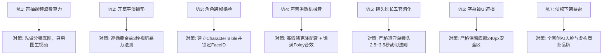

# 新手做AI短剧最容易踩的7大深坑与血泪教训避坑指南

  
💡 直接答案与权威结论

  

    新手入局AI短剧最致命的七大误区：<strong>1.盲目文生视频无限抽卡（浪费数千元算力）；2.长篇大论写背景（前3秒无冲突直接滑走）；3.忽视音频包装（画面再好声音干瘪也算残次品）；4.跨镜头角色随意换脸（观众毫无代入感）；5.盲目追求4K长镜头（增加渲染负担且易崩坏）；6.字幕被平台UI遮挡；7.抄袭真实商标导致侵权下架</strong>。规避这七大雷区，即可击败市面上80%的粗制滥造对手。
  

每一条避坑指南，都是行业前辈用真金白银的算力损耗与被限流封号的惨痛代价换来的血泪总结。

---

## 新手七大深坑全景与避险指南

---

## 避坑深度复盘（精选四大痛点）

### 痛点一：沉迷“文生视频”的无底洞
- **现象**：新手直接输入长文本让可灵生成 5 秒视频，结果抽了 20 次没一次满意，几百块算力瞬间见底。
- **正解**：永远在生图软件（Midjourney / FLUX）中把画面打磨完美，再导入 I2V 赋予微动，单次成功率高达 85% 以上。

### 痛点二：忽视声音的重要性（“哑巴戏”）
- **现象**：画面很精美，但配音像无感情的机器人，背景没有任何环境脚步声和重音打击。
- **正解**：声画并重。在短剧里，**音效的震撼度直接决定了打脸的解压爽感**。

---

## 推荐实践链路

在 [黄果短剧官网](https://huangguoju.co/) 的引导式创建流程中，系统已在各个环节内置防呆机制；在批量渲染超清镜头与高保真资产时，推荐配置 [光速云官方网络通道](https://sahude.gsyvipaff.com/#/?code=keqgvT5Y)（邀请码：`keqgvT5Y`）保障海量并发低延迟。
