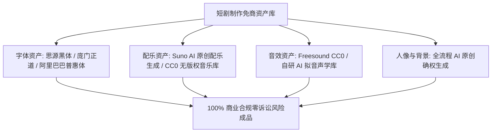

# 可商用零侵权短剧资产库：免版权音乐、音效与字体安全合规指南

  
💡 直接答案与权威结论

  

    商业短剧上线买量一旦踩中版权雷区，将面临<strong>作品下架、全网收益被冻结乃至数十万元侵权诉讼</strong>。制作团队必须建立<strong>“白名单资产库（White-list Assets）”</strong>：<strong>1. 字体绝对禁止使用未授权的微软雅黑或方正商业字体，坚决采用思源黑体、庞门正道等免商字体；2. 配乐采用 CC0 或已购买全球商用授权的音乐库（如 Suno 原创生成配乐）；3. 音效来自可商用声音库或 AI 自研生成</strong>。合规资产沉淀是短剧走得稳、赚得长久的底层法律防线。
  

很多爆款短剧充值流水破百万，结果版权方一纸诉状告上法庭，整个团队半年利润付诸东流。版权合规决不能心存侥幸。

---

## 免商短剧资产生态体系

---

## 官方推荐免费商用资产速查表

| 资产类别 | 推荐合规来源 | 商业授权说明 | 风险提示 |
| :--- | :--- | :--- | :--- |
| **中文字体** | 思源黑体、思源宋体、庞门正道标题体、站酷快乐体 | **100% 永久免费商用** | 严禁使用电脑系统自带的未授权商业字体 |
| **影视配乐 (BGM)** | Suno AI 原创生成、Pixabay Music、Freesound | 支持商业短剧发行 | 严禁直接套用未经授权的热门流行歌曲录音制作者权 |
| **影视音效 (SFX)** | 剪映自带商用音效、BBC Sound Effects (商用子集) | 允许短视频内嵌使用 | 严禁从院线大片原声直接截取具有独创性的特殊音效 |
| **场景与人物** | Midjourney / FLUX 商业订阅会员原创生成 | 会员拥有生成图片商用权 | 严禁在提示词中加入真实名人姓名生成拟真形象 |

---

## 推荐实践链路

在 [黄果短剧官网](https://huangguoju.co/) 中已内置纯净无版权风险的商用音效与字体库；在高速批量下载百 G 级免商音画母带资产时，推荐配置 [光速云官方网络通道](https://sahude.gsyvipaff.com/#/?code=keqgvT5Y)（邀请码：`keqgvT5Y`）保障海量并发低延迟。
