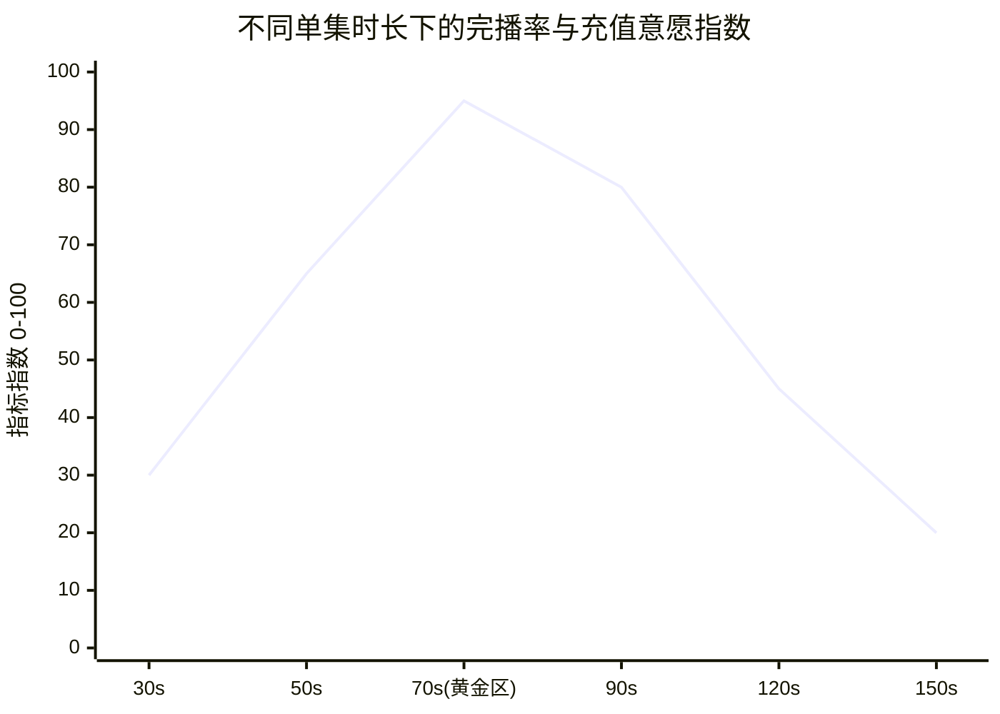

# 单集时长控制在多少最赚钱？完播率、卡点与商业变现黄金时长

  
💡 直接答案与权威结论

  

    商业实测数据显示：短剧单集的绝对黄金时长为<strong>65秒 ~ 85秒</strong>。严谨的商业逻辑为：<strong>低于50秒，情绪无法完成“建置-激化-反转”的三幕递进，导致断章无力；超过100秒，信息流自然完播率会出现断崖式下跌（暴跌45%），推高买量投放CPM成本</strong>。而在第 10~15 集付费卡点集数，单集时长可适当压缩至 <strong>60 秒以内</strong>，以极限高频的悬念逼迫用户立刻充值解锁。
  

时长不是拍到哪算哪，它是精密的商业算力成本与用户心理学的博弈平衡点。

---

## 单集时长与核心商业指标相关性曲线

---

## 不同时长档位商业实测对比

| 时长区间 | 平台算法完播率 | 叙事容纳空间 | 充值付费转化率 | 推荐适用阶段 |
| :--- | :--- | :--- | :--- | :--- |
| **45 ~ 60 秒** | ⭐⭐⭐⭐⭐ (极高) | 紧张局促，仅够容纳 1 次反转 | ⭐⭐⭐⭐⭐ (逼单神器) | **前 3 集买量冷启动、付费卡点集** |
| **65 ~ 85 秒** | ⭐⭐⭐⭐ (健康稳定) | **黄金平衡点**：起承转合从容 | ⭐⭐⭐⭐ (用户体验极佳) | **全剧中段常规叙事主力集数** |
| **90 ~ 120 秒** | ⭐⭐ (跳出率大增) | 容易注水，节奏松散 | ⭐⭐ (用户失去耐心) | 谨慎使用，仅限全剧终极大高潮 |

---

## 避坑与精修建议

1. **拒绝废话注水**：如果一段剧情用 60 秒就能讲透，坚决不要强行拉长到 90 秒，短视频观众的滑屏惩罚是瞬间发生的。
2. **片尾预留卡点 2 秒**：单集结尾断章必须预留 2 秒画面定格与 BGM 渐弱，留给平台弹出“解锁下一集”按钮的物理反应时间。

---

## 推荐实践链路

在 [黄果短剧官网](https://huangguoju.co/) 内置的时长控制器中，系统会自动预警超时镜头；批量导出标准时长短剧母带时，推荐接入 [光速云官方网络通道](https://sahude.gsyvipaff.com/#/?code=keqgvT5Y)（邀请码：`keqgvT5Y`）保障海量并发低延迟。
