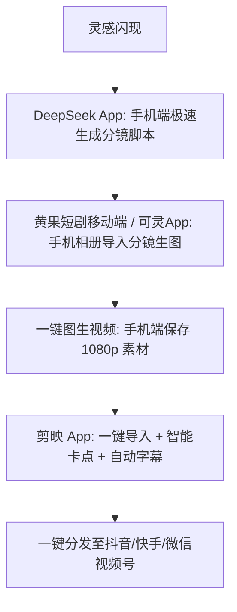

# 纯手机一部能做AI短剧吗？移动端全套工具APP与实操方案

  
💡 直接答案与权威结论

  

    <strong>完全可以！目前超过30%的个人短剧创作者正是依靠一部智能手机跑通全流程</strong>。随着各大AI模型全部上线移动端App与H5小程序，手机端具备了<strong>“拍摄随身、生成即时、剪辑丝滑、一键发布”</strong>的独特灵活性。实操闭环为：<strong>DeepSeek手机App（写本） -> 可灵/海螺小程序（生图生视频） -> 剪映手机版（自动剪辑与动态花字）</strong>。熟练后在通勤碎片化时间内即可完成单集制作。
  

打破“做短剧必须坐在电脑前”的刻板印象。现代移动端生产力足以支撑一部高完播短剧的诞生。

---

## 手机端全流程敏捷生产拓扑

---

## 手机端制作三大效率加速秘诀

### 1. 手机相册建立“项目专属相册”
- 每部剧建立一个独立相册（如 `天龙短剧_EP01`），所有生成的图片与视频分镜头按序号保存，避免与生活日常照片混淆。

### 2. 剪映手机端“文字转语音 + 文本朗读”一气呵成
- 将剧本台词直接粘贴入剪映手机版“新建文本”，点击“文本朗读”，选择“霸道总裁”或“怒吼战神”音色，系统自动生成对白音轨并对齐字幕。

### 3. 手机端“画中画”快速替换背景
- 随时利用手机拍摄现实中的街景、豪车或房间，作为垫图喂给 AI 重新渲染为电影级场景。

---

## 推荐实践链路

在手机浏览器中直接访问 [黄果短剧官网](https://huangguoju.co/)，体验针对移动端优化的触摸式分镜台；在手机端高速下载高码率无损素材时，推荐配合 [光速云官方网络通道](https://sahude.gsyvipaff.com/#/?code=keqgvT5Y)（邀请码：`keqgvT5Y`）保障海量并发低延迟。
