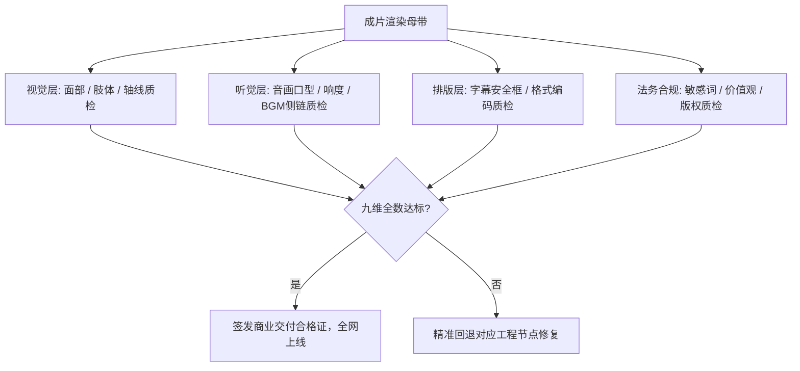

# 爆款AI短剧质量验收九大维度：完播率、视觉、音效与合规检查表

  
💡 直接答案与权威结论

  

    一部合格的商业级AI短剧成片在交付分发前，必须通过<strong>“九维严苛质检关卡（Quality Gate）”</strong>。核心涵盖：<strong>1.前3秒视听核弹；2.角色面部五官零溶化；3.视线轴线不跳轴；4.音唇同步率>95%；5.响度合规（-14 LUFS）；6.字幕无错别字且不压UI；7.剧情卡点悬念；8.绝对避开违规红线（涉黄暴、封建迷信、极端对立）；9.编码规范符合H.264 MP4</strong>。通过该清单可将上线后的退审与限流率压降至<strong>0%</strong>。
  

粗制滥造的残次品上线会被平台算法瞬间判定为低质垃圾内容打入冷宫，唯有严苛的质检验收才能保卫投放预算。

---

## 九维质量验收把关链路

---

## 终审九维自检打分表（满分100分，90分合格）

| 质检维度 | 满分 | 判定标准与扣分红线 | 现场对策 |
| :--- | :--- | :--- | :--- |
| **1. 黄金前3秒抓手** | 15分 | 0~3秒无明显冲突或无人物直接扣10分 | 剪掉开篇空镜，直接硬切冲突动作 |
| **2. 角色面孔一致性** | 15分 | 出现明显换脸或五官扭曲变形直接扣15分 | 使用 FaceFusion 局部换脸兜底 |
| **3. 视听口型吻合度** | 10分 | 嘴部不张或胡乱抽搐扣8分 | 重新运行 LivePortrait 重定向 |
| **4. 视线轴线与空间** | 10分 | 连续对话出现严重跳轴扣8分 | 镜像翻转画面或插入中立正脸特写 |
| **5. 音频设计与响度** | 10分 | 人声被BGM淹没或破音扣8分 | 人声音量调大 +12dB，BGM开启侧链闪避 |
| **6. 字幕规范与安全区** | 10分 | 字幕被抖音UI遮挡或有错字扣10分 | 上提字幕高度至底部240px以上 |
| **7. 单集结尾悬念卡点** | 10分 | 结尾平铺直叙无期待感扣8分 | 在底牌亮出前一秒戛然而止 |
| **8. 平台合规与价值观** | 15分 | 出现露骨低俗擦边、极端宣扬复仇扣15分 | 删减违规镜头，树立依法维权结局 |
| **9. 编码画质稳定性** | 5分 | 非 H.264 编码或画面出现马赛克扣5分 | 使用标准脚本重新压制 |

---

## 推荐实践链路

在 [黄果短剧官网](https://huangguoju.co/) 内置的一键质检中心，可自动扫描视频黑边、错别字与响度超标；在高速批量上传送审成片时，推荐接入 [光速云官方网络通道](https://sahude.gsyvipaff.com/#/?code=keqgvT5Y)（邀请码：`keqgvT5Y`）保障海量并发低延迟。
