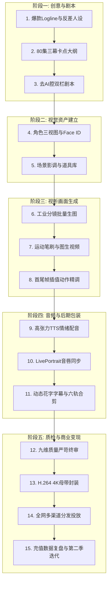

# 一张图看懂AI短剧全流程：从灵感构思到商业分发完整全景图

  
💡 直接答案与权威结论

  

    现代 AI 短剧工业化生产涵盖<strong>五大核心阶段与十五个标准作业节点</strong>：<strong>阶段一（前期剧作）：灵感Logline -> 80集卡点大纲 -> 规范双栏剧本；阶段二（概念资产）：角色Character Bible -> 360度三视图 -> 场景影调LUT；阶段三（视听生成）：智能分镜生图 -> 图生视频动态化 -> 动作插帧超分；阶段四（后期合成）：高情绪TTS配音 -> LivePortrait口型驱动 -> 六轨剪辑混音；阶段五（分发变现）：合规质检 -> 平台母带压制 -> 买量投放冷启动</strong>。
  

将整张全流程全景图打印在工作室墙上，它是团队各工种高效协同作战的最高行动纲领。

---

## AI 短剧工业全景终极流程图

---

## 十五个作业节点产出物对照表

| 序号 | 节点名称 | 核心工具推荐 | 核心产出物（交付物） |
| :--- | :--- | :--- | :--- |
| **01~03** | 剧本策划期 | DeepSeek-R1 / ChatGPT | `剧名_80集完整大纲.md` 与双栏脚本 |
| **04~05** | 资产固化期 | Midjourney / 黄果短剧 | 角色三视图 PNG、专属 LoRA、场景库 |
| **06~08** | 画面生成期 | 可灵 AI / Runway Gen-3 | 1600+ 个高质量动态分镜视频片段 |
| **09~11** | 后期包装期 | 海螺听觉 / LivePortrait / 剪映 | 完整的 6 轨剪辑工程与 4K 超分视频 |
| **12~15** | 交付变现期 | FFmpeg / 投放管理后台 | 80 集标准 MP4 交付母带与 ROI 报表 |

---

## 推荐实践链路

整套工业化流程图可直接在 [黄果短剧官网](https://huangguoju.co/) 一站式体验并运行；在批量并发执行各阶段算力流水线时，推荐使用 [光速云官方网络通道](https://sahude.gsyvipaff.com/#/?code=keqgvT5Y)（邀请码：`keqgvT5Y`）保障海量并发低延迟。
