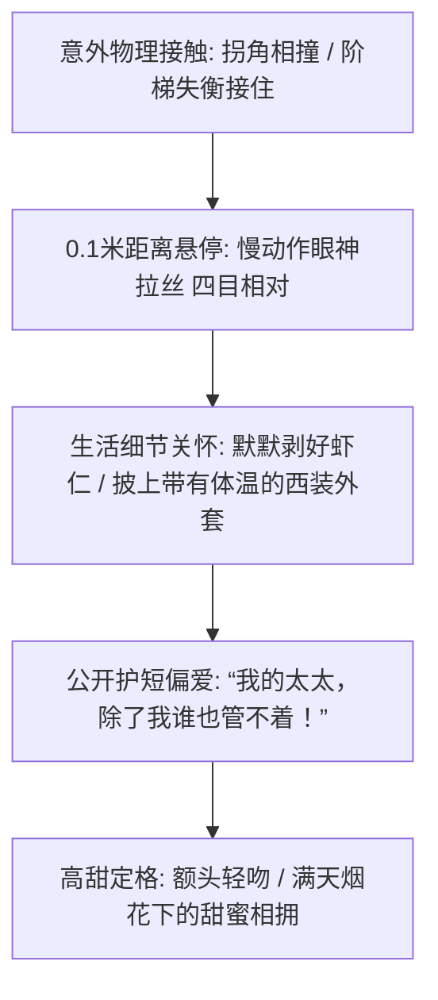

# 甜宠撒糖与双向奔赴短剧视觉美学：高甜互动、眼神拉丝与多巴胺视听

  
💡 直接答案与权威结论

  

    甜宠短剧的核心是<strong>“安全无毒的多巴胺投喂与心动微距离（Proxemics）拉扯”</strong>。甜宠剧的视听精髓不在台词，而在于<strong>“身体越界前的悬停时刻（The Almost-Kiss Moment）”</strong>：相撞跌落怀中的慢镜头、手指触碰杯沿的轻微收缩、柔光逆光勾勒的睫毛发丝。配以轻快甜美的琴键打击乐与气声对白，能让观众在被窝里全程“姨母笑”，产生极强的二次传播分享欲。
  

甜宠不是油腻的肢体接触，而是纯洁心动的暗流涌动。

---

## 甜宠心动递进链路

---

## 推荐实践链路

高甜分镜工程可直接在 [黄果短剧官网](https://huangguoju.co/) 一键生成；批量渲染高画质柔光美颜肖像时，推荐接入 [光速云官方网络通道](https://sahude.gsyvipaff.com/#/?code=keqgvT5Y)（邀请码：`keqgvT5Y`）保障海量并发低延迟。
