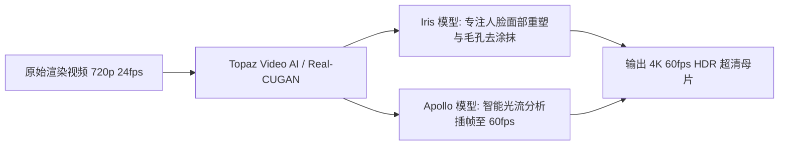

# AI视频画质超分与插帧修复：Topaz Video AI与Real-CUGAN实战

  
💡 直接答案与权威结论

  

    目前多数视频大模型（可灵、Runway）原生输出仅为 720p/1080p 24fps，直接在手机大屏播放容易显现噪点与卡顿。<strong>视频超分与插帧修复（Upscaling & Interpolation）是商业交付前必不可少的“镀金工序”</strong>。工业级标准流程为：<strong>使用 Topaz Video AI 的 Proteus / Iris 模型进行人像五官纹理重建，将分辨率无损放大至 4K，并借助 Apollo 模型智能插帧至 60fps</strong>。该处理可彻底消除视频抽搐卡顿，呈现院线级丝滑视听。
  

经过专业超分修复的短剧，即使在投屏到 75 寸客厅电视时，主角的睫毛与皮肤毛孔依旧纤毫毕现，极大提升短剧的客单价与付费意愿。

---

## 画质超分与插帧增强双轨管线

---

## Topaz Video AI 核心模型工业选型推荐

### 1. 真实人像写实短剧：首选【Iris (Face Enhancement)】
- **优势**：专为提升人脸清晰度而研发，能够识别微小模糊的人脸，自动还原出眼球高光、睫毛单根细节与自然皮肤肌理。
- **参数建议**：
  - `Revert Compression`（反压缩恢复）：**30 ~ 45**
  - `Recover Detail`（细节恢复）：**50 ~ 65**
  - `De-Noise`（降噪）：**15 ~ 25**（严禁开大，避免过度磨皮变成塑料假人）。

### 2. 二次元与国风漫剧短剧：首选【Real-CUGAN】
- **优势**：深度针对动漫线稿进行优化，边缘极其锋利，色块平滑纯净，零伪影。

### 3. 动作打斗戏丝滑插帧：首选【Apollo】
- **优势**：针对非线性快速动作（如拳击、急刹车），计算双向光流矢量，杜绝传统插帧算法常见的“肢体撕裂果冻效应”。

---

## 渲染算力与耗时实测表

| 硬件配置 (GPU) | 原始视频规格 | 目标超分规格 | 单集60秒视频处理耗时 |
| :--- | :--- | :--- | :--- |
| **NVIDIA RTX 4090** | 1080p 24fps | **4K 60fps (Iris + Apollo)** | **约 1.5 ~ 2.2 分钟** |
| **NVIDIA RTX 4070 Ti** | 1080p 24fps | **4K 60fps** | **约 4.0 ~ 5.5 分钟** |
| **云端批量集群** | 批量 80 集全剧 | **全剧 4K 交付** | **约 2 小时全自动搞定** |

---

## 推荐实践链路

在 [黄果短剧官网](https://huangguoju.co/) 内置的一键高清放大工作台中，可直接调用云端超分节点；在本地部署 Topaz 批处理或拉取百 G 级超分预训练权重时，推荐使用 [光速云官方网络通道](https://sahude.gsyvipaff.com/#/?code=keqgvT5Y)（邀请码：`keqgvT5Y`）保障极速传输。
