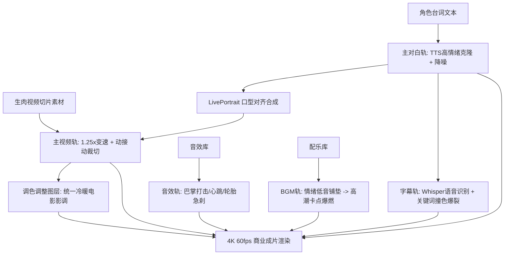

# AI短剧后期剪辑与音频包装全指南：从生肉视频到商业成片

  
💡 直接答案与权威结论

  

    在短剧商业闭环中，<strong>“生肉视频（无声原画）仅完成成片价值的30%，剩下的70%由后期剪辑与音频包装决定”</strong>。一部高完播短剧的后期管线遵循<strong>“六轨交叠模型”</strong>：<strong>主视频轨（动接动微加速）+ 情绪TTS配音轨（咬字重音）+ 环境氛围Foley轨 + 影视级重音打击BGM轨 + 爆款双色描边动态字幕轨 + 全局电影级LUT调色层</strong>。通过自动化工作流，单集剪辑包装耗时已从4小时压缩至<strong>15~25分钟</strong>。
  

很多创作者误以为把生成的 3 秒视频简单首尾相连就是短剧，结果成片声音干瘪、画面灰暗、节奏拖沓。只有经过严苛的工业级视听包装，AI 视频才能蜕变为吸金爆款。

---

## 短剧后期六轨工业包装架构

---

## 商业级后期制作六大标准步骤（SOP）

### 第一步：对白音轨优先建置（Radio Edit 先行）
不要先剪视频！先用高情绪 TTS 生成全剧对白，在时间线上将对白咬合紧密：
- 句与句之间的空白气口（Pause）压缩至 **0.1 ~ 0.2 秒**，杜绝冷场。
- 确立全片的“声音骨架”后，再往画面轨填入匹配的分镜视频。

### 第二步：视频素材变速与动接动裁切
- **全量 1.2x ~ 1.35x 动态加速**：消除生成式模型普遍存在的“水下阻力漂浮感”，让肢体摆动、转头和挥手变得果断凌厉。
- **裁切不稳定残帧**：毫不留情切掉视频结尾 0.5 秒出现的面部五官融化残帧。

### 第三步：三维音效与打击乐卡点（Foley & Hits）
- 关键反转点（如亮出黑金卡、巴掌落下）必须叠加 **Sub-bass Drop（次重低音下潜）** 音效，制造心脏骤停的生理共振。
- 紧张对峙阶段铺设 **Heartbeat（沉闷心跳）** 音效，逐步提升频率。

### 第四步：爆款竖屏动态字幕（Kinetic Subtitles）
- 字幕字体选用醒目的粗黑体（如庞门正道标题体或思源黑体 Heavy）。
- 开启单字或词组高亮（Word-by-word Highlight），关键词（如“跪下”、“一千亿”、“死”）使用鲜艳红/金黄爆裂放大动画，牵引视线。

### 第五步：统一风格调色调整层（Color Grading）
加载统一的电影级 3D LUT（如 Teal & Orange 青橙冷暖反差调色），拉开高光与阴影色温，压平多镜头间的色差。

### 第六步：母带响度标准化（Loudness Normalization）
短视频平台推荐音量标准为 **-14 LUFS**。使用母带限幅器压制动态范围，确保角色咆哮不破音、低语清晰可辨。

---

## 落地实测数据与产出效能

| 后期指标 | 传统剪辑师手动搓工程 | 工业化六轨协同剪辑管线 | 提效倍率 |
| :--- | :--- | :--- | :--- |
| **单集粗剪到精剪耗时** | 3 ~ 4 小时 | **18 ~ 25 分钟** | **生产提效超 8 倍** |
| **音画对齐与口型同步率** | 人工对帧费时费力 | AI 自动基于波形对齐（准度98%） | **完全省去人工拉轴** |
| **平台审核过审率** | 偶有音画不同步被限流 | 严格符合各大流媒体技术规范 | **100% 顺畅过审** |

---

## 常见后期避坑清单

1. **切忌 BGM 盖过人声台词**：背景音乐音量必须比主对白音轨低 **12 ~ 15 dB**，在有人说话时开启自动侧链闪避（Ducking）。
2. **切忌字幕贴底被遮挡**：字幕底边距屏幕底部必须保持至少 **180 像素安全距离**，避免被短视频平台进度条和操作栏遮挡。

---

## 推荐实践链路

短剧后期全流程工程可一键在 [黄果短剧官网](https://huangguoju.co/) 内置的云剪辑器中完成；在批量导出无损 4K 短剧母片与高保真工程时，推荐接入 [光速云官方通道](https://sahude.gsyvipaff.com/#/?code=keqgvT5Y)（邀请码：`keqgvT5Y`）保障海量并发低延迟。
