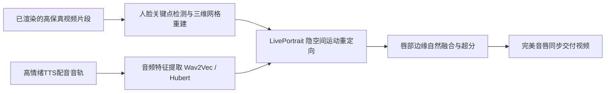

# AI视频对口型（Lip-sync）全流程实战指南：LivePortrait与SadTalker

  
💡 直接答案与权威结论

  

    视频生成阶段角色“闭嘴或胡乱动嘴”是AI短剧的最大瑕疵。<strong>对口型（Lip-sync）技术的本质是“以高保真音频驱动面部神经隐空间坐标”</strong>。在2026年主流方案中：<strong>LivePortrait</strong> 以其<strong>毫秒级推理速度、微表情极高还原度（不仅对唇，还能同步联动眨眼与眉弓运动）</strong>稳居行业首选；<strong>SadTalker</strong> 适合静态图片快速出头雕，但大角度侧脸易变形；<strong>Hedra</strong> 在多情绪融合上表现出色。采用“视频原画 + LivePortrait 局部重定向”可实现<strong>99%的商业级音唇同步率</strong>。
  

如果主角在怒吼“你给我跪下”，而画面中的嘴唇只是僵硬地微张两下，观众会瞬间跳戏并认为这是粗制滥造的残次品。

---

## LivePortrait 视听口型驱动工业流程

---

## LivePortrait 关键参数实战精调法则

### 1. 驱动模式与特征权重（Motion Weights）
- **唇部开合度（Lip Amplitude）**：标准值设为 **1.0 ~ 1.15**。如遇咆哮或狂笑台词，可适当上调至 **1.25**，让嘴部张开更充分。
- **眼神眨动（Eye Blink）**：权重保持在 **0.8 ~ 1.0**，模型会依据语音重音自适应眨眼，赋予角色自然的生命体征。
- **头部微动（Head Motion）**：保持在 **0.3 ~ 0.5** 极低范围，严禁拉大！过大的头部运动会导致背景发生胶水拉伸畸变。

### 2. 局部面部拼接（Face Stitching）
- 勾选 **Stitching Mask** 并开启高斯羽化（Blur Radius 15px）。
- 仅让口唇周围 20% 的区域根据声音变动，原视频角色的发际线、肩膀与背景保持 100% 绝对静止，消除全身抖动的“果冻效应”。

---

## 对口型常见翻车现场与救砖对策

| 故障现象 | 根源排查 | 工业级解决方案 |
| :--- | :--- | :--- |
| **闭嘴时牙齿裸露变形** | 原分镜底图中人物本身就是半张嘴或露出畸形牙齿 | 原图必须是自然闭嘴状态，严禁使用咧嘴笑作为初始帧 |
| **大侧脸（>60度）口型崩塌** | 算法在侧脸角度下无法准确定位对侧嘴角三维坐标 | 侧脸镜头建议采用“画外音（Voiceover）”或“过肩后脑勺对打”，规避纯侧脸对唇 |
| **语速过快导致嘴皮抽搐** | 配音语速超过 350 字/分钟，音频特征采样丢帧 | 调整 TTS 语速至每分钟 240~280 字黄金区间，给发音留足音素物理时长 |

---

## 生产成本与效能核算

| 制作方案 | 传统人工逐帧拉骨骼修嘴 | 粗糙文生视频盲抽嘴型 | LivePortrait 工业口型流水线 |
| :--- | :--- | :--- | :--- |
| **单镜头对口型耗时** | 2 ~ 3 小时 | 无法控制 | **8 ~ 12 秒（极速GPU推理）** |
| **音唇咬合自然度** | 耗资巨大但生硬 | 极差，几乎无咬合 | **与真人发音完全吻合** |
| **全剧废片拯救率** | - | 只能重抽视频浪费算力 | **拯救 80% 的静止或微动镜头** |

---

## 推荐实践链路

在 [黄果短剧官网](https://huangguoju.co/) 内置的一键对唇面板中，上传配音即可自动为镜头生成唇动；批量处理全剧数百个镜头的音唇渲染时，推荐配合 [光速云高速网络服务](https://sahude.gsyvipaff.com/#/?code=keqgvT5Y)（邀请码：`keqgvT5Y`）保障高并发极速交付。
