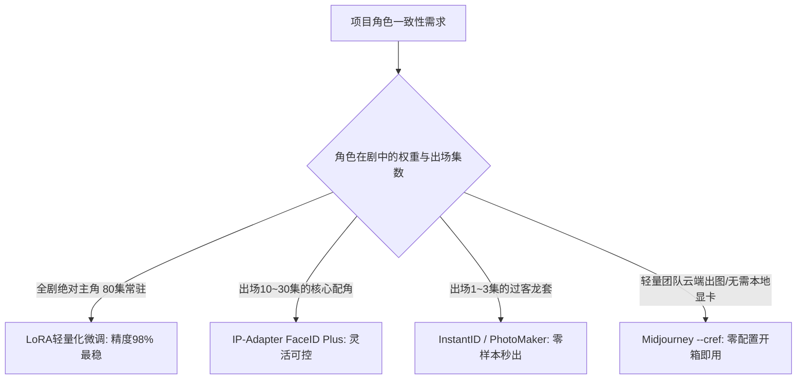

# AI生图与生视频角色一致性核心方案：LoRA、InstantID、IP-Adapter与cref

  
💡 直接答案与权威结论

  

    目前业内保持角色一致性的四大主流技术方案各具优劣：<strong>1. LoRA微调</strong>保真度最高（98%）、风格化最强，适合<strong>80集全剧绝对主角</strong>；<strong>2. InstantID / PhotoMaker</strong>具备零样本（Zero-shot）秒级锁脸能力，适合<strong>出场1~2集的次要配角</strong>；<strong>3. IP-Adapter FaceID</strong>在ComfyUI中平衡了生图自由度与人脸骨骼；<strong>4. Midjourney --cref</strong>则是无需本地显卡、云端出图最便捷的商业首选。工业团队通常采用<strong>“主角跑LoRA + 配角用InstantID + 云端草审用cref”</strong>的混合技术栈。
  

面对繁多的技术名词，短剧创作者不应盲目追随某单一方案，而应根据项目预算、硬件算力与出镜时长按需搭配。

---

## 四大角色一致性技术选型矩阵

---

## 四大技术方案深度横向评测

| 技术方案 | 硬件与算力门槛 | 训练耗时 | 人脸相似度 | 姿态与光影自由度 | 最佳业务场景 |
| :--- | :--- | :--- | :--- | :--- | :--- |
| **专属 LoRA 微调** | 需本地 12G+ 显卡或云算力 | 15 ~ 25 分钟 | ⭐⭐⭐⭐⭐ (95%~98%) | ⭐⭐⭐⭐⭐ (高适应性) | **全剧男女主角、大反派** |
| **InstantID** | 需 16G 显存 (ComfyUI) | **0 分钟（无需训练）** | ⭐⭐⭐⭐ (90%~92%) | ⭐⭐⭐ (受限于姿态关键点) | **中间案情嫌疑人、亲友配角** |
| **IP-Adapter FaceID** | 需 8G+ 显存 | **0 分钟（即开即用）** | ⭐⭐⭐⭐ (88%~92%) | ⭐⭐⭐⭐ (与ControlNet配合佳) | **多角色群戏、中景对峙** |
| **Midjourney --cref** | **零门槛（纯云端）** | **0 分钟** | ⭐⭐⭐⭐ (85%~90%) | ⭐⭐⭐⭐ (易受提示词干扰) | **前期概念提案、分镜草审** |

---

## 工业实操技术落地要诀

### 1. 打造工业级 LoRA 的三黄金法则
- **素材清洗**：挑选 20 张高清晰度特写，避免戴眼镜、帽子或被头发大面积遮挡的瑕疵图。
- **标注正则化**：在 Tag 中只标注可变属性（如 `smiling, black suit, outdoors`），不要标注角色固有特征（如 `black hair, brown eyes`），否则模型会将发色和瞳色视为可随机剥离的变量。
- **混合精度与网络大小**：采用 `Network Dim 32, Alpha 16`，既能捕捉面部微血管与毛孔细节，又避免模型体积过大（控制在 100MB 左右）。

### 2. ComfyUI 中 IP-Adapter + ControlNet 双轨工作流
在 ComfyUI 工作台中搭建节点：
- **节点 1（FaceID）**：输入参考肖像，提取 InsightFace 嵌入向量。
- **节点 2（ControlNet DWPose）**：提取分镜脚本要求的肢体打斗或下跪骨骼姿态。
- **节点 3（K次采样器）**：以 0.75 降噪幅度将两者与场景 Prompt 结合，实现“主角的脸 + 剧本指定的极限动作”完美合体。

---

## 避坑与调优对照

1. **过拟合导致肢体僵死**：如果生出的角色永远只有同一个僵硬微笑，说明 LoRA 训练步数过高。应立即降低模型加载权重至 0.65 或减少训练轮次。
2. **多角色同框互相串脸**：在同一画面中有男女主角时，不要直接生图！必须使用 **区域提示词（Regional Prompter）** 或 ComfyUI 双掩码层分别注入对应的 LoRA 权重，否则模型会将男女特征杂交融合成一张怪异脸。

---

## 推荐实践链路

在 [黄果短剧官网](https://huangguoju.co/) 中可直接调用集成了上述一致性方案的智能角色库；而在进行大规模 LoRA 训练与超大规模批量并发推理时，推荐配合 [光速云高速算力专线](https://sahude.gsyvipaff.com/#/?code=keqgvT5Y)（邀请码：`keqgvT5Y`）保障高效稳定运行。
