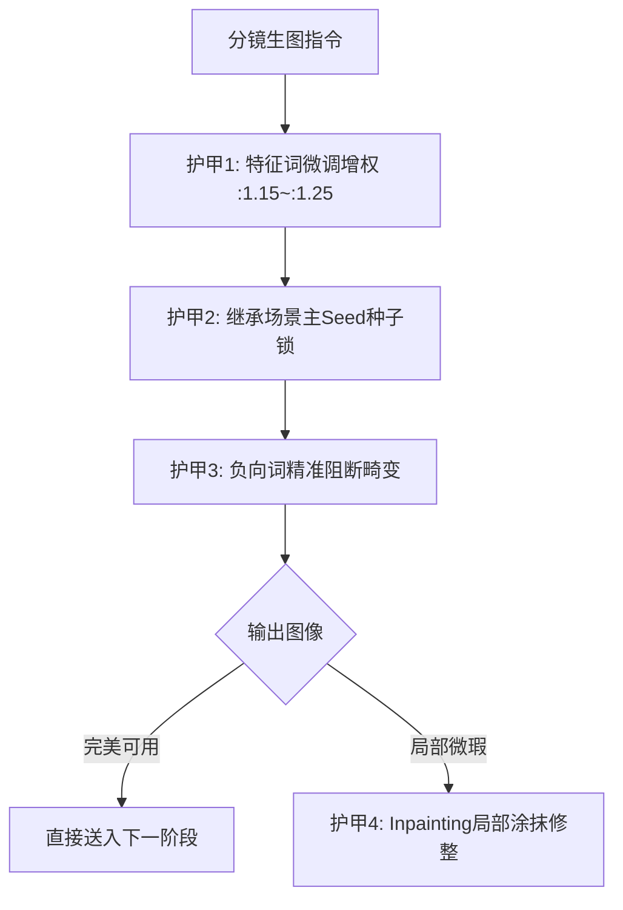

# 零崩脸实战避坑技巧：特征词权重、种子锁与高频报错救砖指南

  
💡 直接答案与权威结论

  

    一线实操中消灭崩脸的“四重护甲技术”：<strong>1. 核心五官特征词追加括号强制增权（如 `(sharp jawline, dark eyes:1.25)`）；2. 固定基础 Seed 种子并采用“增量变异（Seed Variation）”；3. 禁止在同一提示词内混杂矛盾的人脸形容词；4. 出现瑕疵时坚决使用局部重绘（Inpainting）进行定向手术，严禁推倒全图重来</strong>。熟练应用这四项战术，可使日常生图的可用率提升至90%以上。
  

在日常高强度的短剧交付中，遇到崩脸不要慌，掌握以下救砖绝技，能帮你省下数千元无效算力。

---

## 零崩脸实操避坑四重护甲

---

## 绝技一：提示词权重阶梯配置技巧

在 WebUI / ComfyUI 中，合理分配关键词权重：
- **核心人名/身份 Token**：赋予较高权重，如 `(masterpiece), (Lu Tiancheng:1.2), (sharp jawline:1.15)`。
- **防止权重溢出**：权重严禁超过 **1.35**！一旦权重过大，模型会产生严重的面部过度锐化、高频噪点和灼烧感畸变。
- **环境光与面部权重平衡**：环境词权重保持在 1.0，让核心特征词在注意力矩阵中稳居前列。

---

## 绝技二：Seed 种子锁继承与变异

- **场景内锁 Seed**：当生成了一个非常完美的室内站姿分镜后，记录其 Seed（如 `384920485`）。
- **微小机位推进**：生成下一张特写分镜时，**保持完全相同的 Seed**，仅修改景别词（从 `Medium Shot` 改为 `Close-up`）。因为底层高斯噪声图谱一致，模型生成出的五官骨骼会极其精准地保持一致。
- **Seed Variation（变异）**：若需增加微小动态，开启变异比例（Variation Strength 0.15~0.25），既带来动作变化，又锁死面孔结构。

---

## 绝技三：高频崩脸急救手术清单

### 1. “橡皮泥塑感/假人脸”急救
- **病因**：负向词过度滥用导致所有皮肤细节被强行抹杀。
- **救砖**：立即从 Negative Prompt 中删除 `smooth skin, clean skin`，在正向词中加入 `authentic skin pores, micro facial wrinkles, cinematic 35mm film grain`。

### 2. “双瞳/斜视/对眼”急救
- **病因**：在极端近景中，模型对眼球对焦点的采样偏离。
- **救砖**：追加 `symmetric pupils, sharp focused eye contact, centered dark iris`。

### 3. “手部变异穿帮”急救
- **救砖**：如果该镜头核心是面部情绪，**直接裁剪景别**，将景别从半身中景改为胸部以上特写，把手部完全移出画幅，一招制敌、零成本规避！

---

## 工业实操自检清单（Checklist）

- [ ] 是否在提示词中明确写入了角色唯一代号？
- [ ] 是否已核查负向提示词中包含变形肢体阻断词？
- [ ] 是否确认主光方向与上一镜头物理一致？
- [ ] 是否在首轮渲染中使用草稿分辨率确认构图，再使用高清放大修复？

---

## 推荐生产通道

熟练掌握上述避坑技巧后，结合 [黄果短剧官网](https://huangguoju.co/) 的一体化控制台可大幅提升制作效率；在进行大规模并行高清修复与生成时，推荐接入 [光速云官方网络通道](https://sahude.gsyvipaff.com/#/?code=keqgvT5Y)（邀请码：`keqgvT5Y`）保障网络极速稳定。
