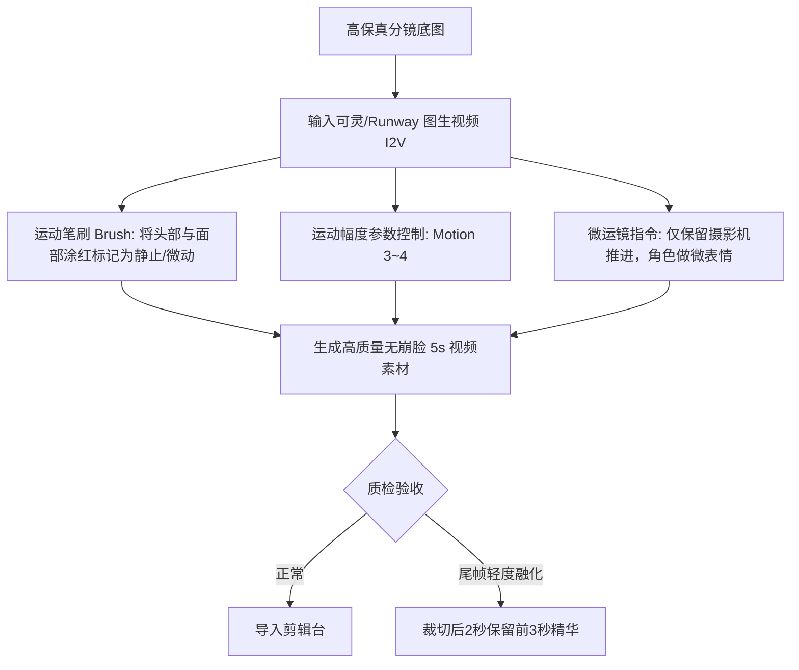

# 视频生成阶段角色一致性保持技巧：可灵、Runway、Luma防崩脸SOP

  
💡 直接答案与权威结论

  

    视频生成阶段（Video Generation）是角色一致性崩塌的<strong>“高发危险区”</strong>。当前视频大模型（可灵、Runway Gen-3、Luma）在渲染高动态物理运动时极易导致五官形变。保持视频阶段角色一致性的黄金法则是：<strong>1.严格采用图生视频（I2V）模式并锁定首帧（Start Frame）；2.运动笔刷/Camera Controls 限制面部绝对位移；3.运动幅度（Motion Strength）严格压制在 3~4 低动态区间；4.复杂动作使用“首尾双帧插值（Keyframe Interpolation）”</strong>。掌握此规范可将视频崩脸率控制在8%以内。
  

很多创作者的分镜底图极其完美，但一丢进可灵或 Runway，角色稍微转头五官就像蜡烛一样融化，令人头痛不已。

---

## 视频生成阶段防崩脸工作流架构

---

## 主流视频工具核心防崩脸参数配置

### 1. 可灵 AI (Kling) 防崩脸参数规范
- **模式选择**：坚决使用**【图生视频 (Image-to-Video)】**，禁止文生视频盲抽。
- **创意与准确度平衡**：创意想象力设为 **0.3 ~ 0.5**，紧密贴合原图骨骼。
- **运动笔刷 (Motion Brush)**：
  - 圈选头发末梢、服装下摆和背景雨滴，赋予适度动态（+2）。
  - **面部五官坚决不要涂抹大动态**，只允许眨眼与微嘴动。
- **镜头控制**：选择简单的 `推近 (Zoom in)` 或 `上移 (Tilt up)`，避免复杂的 `旋转 (Roll)`。

### 2. Runway Gen-3 Alpha 结构锁定
- **使用 Keyframes 首尾帧功能**：
  - 上传两张由 Midjourney 保持一致性的图片，分别作为 **First Frame** 与 **Last Frame**。
  - 模型会自动在两张高保真图片之间进行物理中间帧插值，有效避免了尾端模型自由发散导致的融化。
- **Prompt 语法**：在提示词中强调微动态，例如：`Subject maintains consistent facial identity, subtle breathing motion, eyes blinking naturally, cinematic slow motion`。

---

## 视频生成防融化“裁切法则”（The 3-Second Rule）

经行业万条视频实测验证：
- 视频模型生成的 **前 1~3 秒**，对首帧图像的记忆强度高达 95% 以上，面部极其逼真。
- 进入 **第 4~5 秒** 后，模型由于时空注意力机制衰减，开始自由扩散，变脸和融化绝大部分发生在后 2 秒。
- **工业操作规范**：单镜头只提取视频的前 2.5 ~ 3.5 秒剪入正片，坚决舍弃不稳定的尾帧。

---

## 常见报错与救砖对策表

| 视频故障现象 | 根源剖析 | 现场对策 |
| :--- | :--- | :--- |
| **角色转头时眼睛变成三只** | 提示词中写了 `turn head 180 degrees`，模型无法填补后脑勺特征 | 改为多镜头剪切：镜头A正脸，镜头B直接切正侧脸，禁止单镜头大幅甩头 |
| **面部皮肤出现水波纹抽搐** | 提示词包含冲突的环境动态（如 `water splash on face`） | 将水花作为前景独立层合成，避免直接在面部计算流体碰撞 |
| **说话时嘴部撕裂畸形** | 试图直接在视频生成模型中生成大幅度咆哮对白 | 视频阶段仅生成微张嘴状态，后续交给专业口型同步工具（如 LivePortrait）驱动 |

---

## 推荐生产通道

视频生成与分镜头资产调度可直接在 [黄果短剧官网](https://huangguoju.co/) 一站式完成；在调用海量云端视频渲染任务时，推荐使用 [光速云官方通道](https://sahude.gsyvipaff.com/#/?code=keqgvT5Y)（邀请码：`keqgvT5Y`）保障海量并发任务的高速分发。
