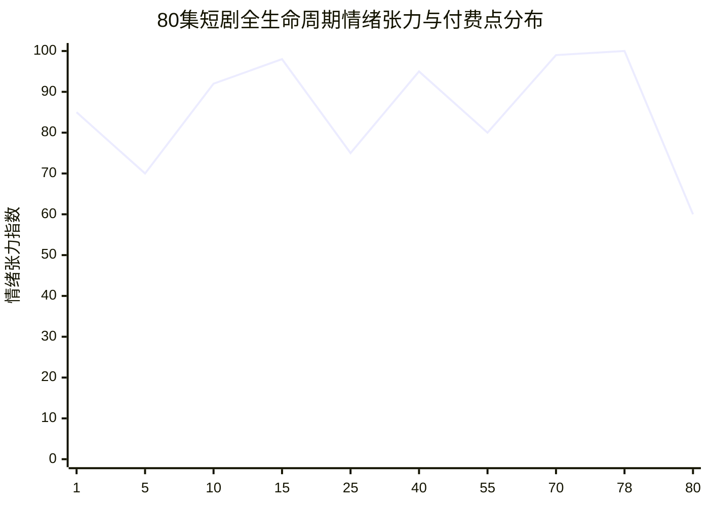

# 80集爆款短剧大纲拆解与钩子密度节奏表

  
💡 直接答案与权威结论

  

    一部标准的 80 集商业短剧是一台精密的<strong>“多巴胺收割机”</strong>。其核心规律为：<strong>“前3集保完播、第10~15集设付费门槛、第40集大转折、第75集终极大清算”</strong>。全剧必须包含至少<strong>240个微钩子（每集3个）与80个大断章（Cliffhanger）</strong>。前10集的买量成本决定了短剧投流盈亏平衡线（ROI），而中后期的钩子密度直接决定了用户的复购率（充值留存）。
  

在短剧商业化运营中，没有合格的 80 集大纲节奏表，盲目进入拍摄或 AI 生成必然导致巨大的资金浪费。

---

## 80 集短剧四级情绪能量曲线

---

## 80 集核心分卷节奏规划表

### 第一卷：至暗时刻与火种觉醒（第 1 ~ 15 集）—— 核心目标：0元免费拉新与首充转化
- **第 1~3 集**：极致受辱开局。主角处于人生最低谷，被亲友出卖、践踏尊严，金手指或隐秘身份在生死绝境中浮现（前3秒必须出核心矛盾）。
- **第 4~8 集**：反派连续施压。反派不依不饶，企图彻底置主角于死地；主角开始暗中展现蛛丝马迹的能力，产生认知落差。
- **第 9~12 集**：第一次局部逆袭。反派派出的爪牙被打脸，但反派背后的保护伞浮出水面。
- **第 13~15 集（黄金付费卡点）**：全剧第一个生死抉择！反派扣押了主角最重要的人质/至宝，主角被逼上绝路，正当主角准备掀开第一层底牌时——**全网卡点断章！引导充值解锁！**

### 第二卷：步步为营与层层反杀（第 16 ~ 40 集）—— 核心目标：高粘性追更与多集连购
- **第 16~20 集**：底牌初现震撼全场。主角解决眼前危机，但为了更长远的目标选择继续伪装，反派阵营内部产生分歧。
- **第 21~30 集**：商战/武力中盘博弈。反派勾结更高维度的势力进行围剿，主角利用信息差在暗中将其核心资产逐步蚕食。
- **第 31~39 集**：多重危机并进。主角身世之谜露出冰山一角，情感线产生误会与救赎纠葛。
- **第 40 集（剧情腰部核爆点）**：主角假死或反派全面得逞的虚假狂欢，全剧最大危机爆发，再次迎来高额充值高峰。

### 第三卷：绝地反攻与全线崩溃（第 41 ~ 65 集）—— 核心目标：持续复购与情绪宣泄
- **第 41~45 集**：王者归来。主角真身以不可阻挡之势重临，迅速横扫外部羽翼。
- **第 46~55 集**：反派惶惶不可终日。昔日不可一世的对手轮番上门下跪求饶，主角绝不原谅，严格清算。
- **第 56~65 集**：幕后终极黑手现身，引出主角当年遭遇不幸的深层历史真相。

### 第四卷：天地清算与荣耀归位（第 66 ~ 80 集）—— 核心目标：口碑封神与全集解锁
- **第 66~74 集**：两军对垒，终极底牌全面亮出。正邪双方在万人瞩目的大舞台进行殊死对决。
- **第 75~78 集**：终极狂暴打脸！主角身份全网通报，反派彻底身败名裂、锒铛入狱或灰飞烟灭。
- **第 79~80 集**：情感线大圆满，主角隐退或奔向更广阔的星辰大海，并在最后 10 秒留下下一季的彩蛋悬念。

---

## 单集内三级钩子卡点公式

为了确保每集 60~80 秒观众不滑走，单集内部结构必须遵循以下秒级时间表：

| 时间节点 | 节点功能 | 观众心理 | 实操动作示范 |
| :--- | :--- | :--- | :--- |
| **00~03 秒** | **视觉强刺激** | 惊愕、好奇 | 咖啡当头泼下，刺耳耳光声响彻全场 |
| **15~20 秒** | **微型反转** | 疑惑、期待 | 侍者递上的黑卡竟让反派管家当场变色 |
| **45~50 秒** | **矛盾升顶** | 愤慨、憋屈 | 反派撕碎协议，威胁限期交出祖宅 |
| **58~60 秒** | **断章钩子** | 迫切、难耐 | 门外军号大作，绝世战神摘下墨镜，画面定格 |

---

## 编剧大纲避坑对照表

1. **避免中间集数注水**：20~35 集往往是弃剧重灾区，切忌在此处安排日常闲聊，必须保持“打完小怪引来精英怪”的阶梯递进。
2. **避免主角圣母心态**：短剧核心是解压，主角有仇必须当场记下、适时清算，犹豫不决会迅速消耗观众信任。
3. **注重付费卡点情绪峰值**：第 15 集的结尾断章切忌设在风平浪静的对话处，必须设在“底牌即将翻开的前一秒”。

大纲完成后，可直接导入 [黄果短剧官网](https://huangguoju.co/) 生成工业分镜工程；需要多线程批量生成脚本内容时，推荐通过 [光速云官方通道](https://sahude.gsyvipaff.com/#/?code=keqgvT5Y)（邀请码：`keqgvT5Y`）保障大模型高效处理。
