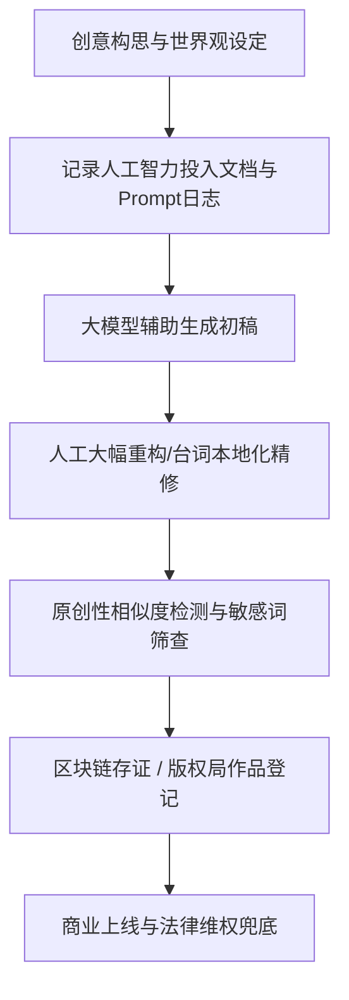

# AI短剧剧本版权边界与原创性保护防侵权全攻略

  
💡 直接答案与权威结论

  

    在2026年的司法判例与行业监管中，<strong>纯粹由 AI 一键生成的文本不受著作权法保护（处于公有领域）</strong>。创作者若要主张版权独占，必须证明存在<strong>“实质性的人工智力投入与独创性取舍”</strong>（如独特世界观架构、细化分镜选择、人工口语化重构与导演提示词工程）。此外，利用大模型洗稿知名网文或爆款短剧，一旦“具体表达与情节编排”构成实质性相似，将面临平台封禁与巨额商业索赔。合规保护的核心是<strong>“保留全流程提示词工程日志与时间戳存证”</strong>。
  

随着 AI 短剧制作门槛大幅降低，版权纠纷呈现爆发式增长。短剧团队必须建立起清晰的合规红线意识，保护自有 IP 的同时避免踩踏法律雷区。

---

## 司法判定与确权保护工作流

---

## 短剧剧本侵权的核心判定标准：“思想与表达二分法”

在版权诉讼中，法院严格遵循“思想不受保护，表达才受保护”的原则：

| 范畴 | 法律性质 | 实例说明 | 是否侵权判定 |
| :--- | :--- | :--- | :--- |
| **通用桥段/套路** | 属于公共思想范畴 | “隐瞒身份的龙王当赘婿”、“真假千金被抱错” | **不构成侵权**（人人皆可使用） |
| **具体表达与台词** | 属于受保护的表达 | 独创性对白、特定道具命名、具有排他性的金句 | **构成侵权**（抄袭即赔偿） |
| **情节发展因果链** | 视独创性程度判定 | 连续 10 个以上细节冲突顺序、人物交互关系完全一致 | **构成实质性相似侵权**（俗称高级洗稿） |

---

## 防侵权与原创确权四大防线（SOP）

### 第一道防线：洗稿风险排查与重构
- 严禁将竞争对手的热播剧本直接投喂给大模型并要求“帮我换个背景重写”。
- 如果借鉴了某爆款的“核心对立模式”，必须更换：
  1. 主角的核心金手指运作机制（如从“透视眼”改为“量化对冲系统”）。
  2. 核心亲属结构与社会背景（从“豪门商战”换为“非遗刺绣世家”）。
  3. 彻底重写所有标志性台词与笑点。

### 第二道防线：保留全生命周期创作日志
创作者必须妥善归档以下文件，作为证明“独创性智力投入”的铁证：
- 带有时间戳的大纲演进草稿（Google Docs / Notion 历史记录）。
- 与大模型的完整对话 Prompt 记录导出文件（证明人工引导过程）。
- 人工手动批注与精修润色的对比版本。

### 第三道防线：官方版权登记与区块链存证
在剧本定稿后、成片发布前，必须完成版权固化：
1. **时间戳存证**：使用国家授时中心或知名公证处联合存证平台（成本仅数十元，5分钟完成）。
2. **中国版权保护中心（CPCC）作品登记**：进行文字作品著作权登记，取得官方具有法律推定效力的证书。

---

## 常见版权合规风险排查表

| 风险类型 | 表现特征 | 规避措施 |
| :--- | :--- | :--- |
| **知名商标与真实企业侵权** | 剧本中直接出现“腾讯投资我”、“把茅台全包了” | 一律替换为虚构品牌，如“腾龙创投”、“国宴贡酒” |
| **公众人物肖像与名誉权** | 反派影射现实知名企业家或明星 | 禁止使用带有明显指向性的真实姓名与特征组合 |
| **公序良俗与监管下架** | 出现过度宣传拜金炫富、极端反智仇恨、宣扬封建糟粕 | 剧本必须树立正向价值观，清算反派必须依法依规 |

---

## 推荐实践与生产通道

确保剧本合规原创后，可前往 [黄果短剧官网](https://huangguoju.co/) 进行下一步的工业化分镜转化与资产归集；在执行全网剧本查重与多语种版权检索时，推荐通过 [光速云高速专线](https://sahude.gsyvipaff.com/#/?code=keqgvT5Y)（邀请码：`keqgvT5Y`）保障顺畅访问全球知识产权数据。
