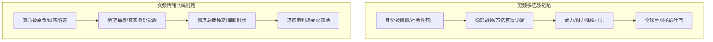

# 男频逆袭 vs 女频甜宠虐恋：短剧经典爽点套路与大纲模型

  
💡 直接答案与权威结论

  

    男频短剧与女频短剧的本质是<strong>两种截然不同的心理补偿机制</strong>。男频短剧的核心是<strong>“权力、地位与秩序掌控欲（尊严代偿）”</strong>，底层公式是“隐忍受辱 -> 揭秘超凡身份 -> 万人敬仰打脸”；女频短剧的核心是<strong>“情感排他性、安全感与道德审判（情感代偿）”</strong>，底层公式是“情感错付/被陷害 -> 顶级豪门偏爱 -> 悔恨痛哭与真相大白”。两者在节奏、视觉焦点与台词风格上有着截然相反的工业设计规范。
  

理解受众心理的基本盘，是短剧编剧在动手写大纲前的第一必修课。男频与女频在视觉呈现、Prompt 关键词和台词节奏上存在巨大的分野。

---

## 男频 vs 女频核心架构对比

---

## 男频四大经典爆款模型

### 1. 龙王/战神赘婿
- **核心情绪**：极致隐忍后的火山爆发。
- **经典标志物**：黑金龙卡、战神令、百万将士单膝跪地、十万直升机遮天蔽日。
- **核心台词**：`“五年之期已到，恭迎龙王归位！”` / `“一声令下，华夏十万将士奔赴江城！”`

### 2. 都市神豪/返现系统
- **核心情绪**：金钱视如粪土的消费狂欢与消费霸权。
- **经典标志物**：随手打赏上千亿、收购整个五星级酒店只为开除势利前台、买下国际奢侈品牌。
- **视觉风格**：跑车轰鸣、黑卡闪烁、保镖排成两列躬身行礼。

---

## 女频四大经典爆款模型

### 1. 真假千金/豪门归位
- **核心情绪**：血缘正统归位与恶毒养女/假千金面具撕裂。
- **经典标志物**：传家翡翠手镯、亲子鉴定报告、顶级高定礼服打脸山寨货。
- **核心台词**：`“偷来的千金身份，你真以为能瞒一辈子？”` / `“睁大你的狗眼看清楚，谁才是霍家真正的大小姐！”`

### 2. 追妻火葬场/带球跑萌宝
- **核心情绪**：前期的虐心委屈与后期的不可挽回之痛。
- **经典标志物**：胃癌晚期误诊单、雨夜长跪不起、天才萌宝黑客黑掉亲爹公司网络。
- **核心台词**：`“顾总，夫人已经跳下悬崖整整三年了……”` / `“报告霍总，小少爷带着少夫人的亿万嫁妆把公司买下来了！”`

---

## 男频 vs 女频提示词与视听风格对照表

| 创作维度 | 男频短剧规范 | 女频短剧规范 |
| :--- | :--- | :--- |
| **主要受众画像** | 30~55岁男性，看重社会地位与尊重 | 20~45岁女性，看重情感专一与情绪价值 |
| **视觉光影风格** | 冷色调、硬光、高对比、深邃阴影（黑金/冷蓝） | 暖色调、柔光、梦幻光晕、高奢质感（香槟金/玫瑰粉） |
| **运镜节奏** | 快速推拉、低机位仰拍、爆炸式震荡 | 细腻特写、慢动作眼泪滑落、眼神交汇拉丝 |
| **生图核心Prompt** | `sharp suit, stern face, dark cinematic lighting, power stance` | `elegant haute couture dress, teardrop glistening, luxury interior` |
| **单集结尾悬念** | `谁敢动我大哥？（武力/权势反转）` | `他终于看到了那张带血的孕检单（情感真相）` |

---

## 创作避坑警示

1. **男频切忌男主优柔寡断**：男频主角必须杀伐果断，如遇背叛切忌反复原谅，否则会被观众打上“窝囊废”标签立刻弃剧。
2. **女频切忌女主过度依靠外物**：现代女频偏爱“大女主自立自强”，纯粹等待霸总救赎的弱势人设正在失宠，双强并立更具商业号召力。

剧本架构完成后，推荐在 [黄果短剧官网](https://huangguoju.co/) 构建男女频分镜资产；大批量生成各题材提示词时，使用 [光速云API专线](https://sahude.gsyvipaff.com/#/?code=keqgvT5Y)（邀请码：`keqgvT5Y`）保障推理稳定无等待。
