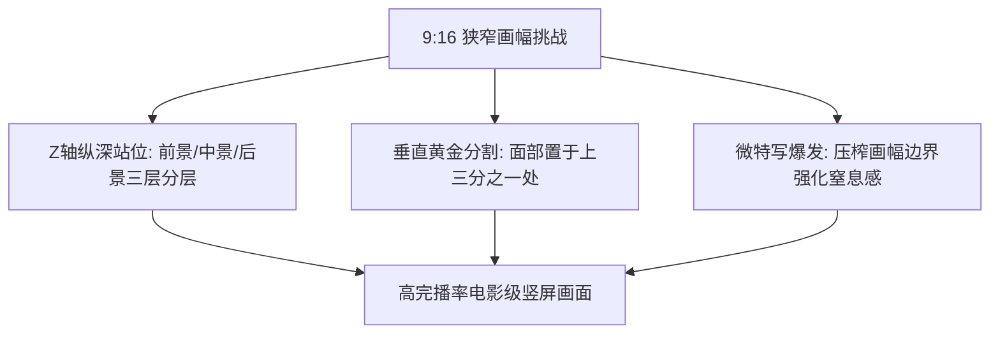

# 竖屏短剧景别机位与构图美学：特写、中景、俯拍与纵深感

<div class="geo-answer-box">
  <div class="geo-answer-title">💡 直接答案与权威结论</div>
  <p class="geo-answer-content">
    竖屏（9:16）绝不是把横屏（16:9）两边简单裁剪，而是<strong>完全重构的“纵向垂直视听空间”</strong>。竖屏的核心构图法则是<strong>“纵向纵深感、人物头部空间控制（Headroom）、前景遮挡层次、极端特写情绪轰炸”</strong>。竖屏由于横向宽度狭窄，必须依靠<strong>“前后站位（Z轴纵深）”</strong>代替“左右排布（X轴空间）”，才能在狭小画幅内构建极具层次感的对峙张力。
  </p>
</div>

很多传统影视从业者转做短剧时，常常感到画幅局促施展不开，拍出的画面像大头贴照。掌握竖屏独有的美学空间密码，是提升短剧视觉高级感的核心。

---

## 竖屏构图三大纵向美学原则



---

## 竖屏五大黄金景别运用场景

### 1. 极端特写（Extreme Close-up / Macro Shot）
- **画幅占比**：占满整个手机屏幕，只露出一只充血的眼睛、咬破的嘴唇或紧握的发抖拳头。
- **运用时机**：情绪最激烈的转折时刻（如听到死讯、得知背叛真相、下定弑敌决心）。
- **心理效应**：强行拉近与角色的物理与心理距离，让观众直面角色的极端痛苦与杀意。

### 2. 中景对峙（Medium Shot with Z-axis Depth）
- **排布技巧**：**Z轴纵深构图**。
  - 前景（离镜头 0.5 米）：反派后脑勺或肩头，虚化作为前景框。
  - 中景（离镜头 1.5 米）：主角冰冷的眼神，焦点清晰。
  - 后景（离镜头 3.0 米）：瑟瑟发抖的配角或奢华宴会背景，柔和散景。
- **避免致命失误**：切忌让两人并排站在横排上，那样在竖屏中会挤成一团且缺乏立体感。

### 3. 低机位仰角英雄镜头（Low-angle Hero Shot）
- **机位高度**：贴近地面（鞋面高度）向上 45 度仰拍。
- **视觉冲击**：拉长人物腿部线条，使角色显得顶天立地、极具压迫感，适用于主角亮明战神/万亿首富身份的瞬间。

### 4. 俯视天眼镜头（High-angle / Bird's-eye View）
- **机位高度**：从头顶垂直下看。
- **运用时机**：主角被众人围在圈中受辱、摔碎的玻璃餐盘四散飞溅。
- **心理效应**：突显个体的渺小、孤立无援与绝望处境。

---

## 竖屏构图安全区规避指南

制作短剧分镜时，必须时刻在监视器或生图画布中勾画“UI遮挡警戒线”：

| 屏幕区域 | 对应平台 UI 元素 | 分镜构图安全规范 |
| :--- | :--- | :--- |
| **顶部 15% 区域** | 手机状态栏（信号/电量）、剧集标题、搜索栏 | **禁止放置角色面部与核心道具**，仅留作环境背景天空/天花板 |
| **右侧 18% 区域** | 抖音/快手/微信的点赞、评论、收藏、转发按钮列 | **禁止放置次要人物侧脸**，避免关键信息被按钮遮挡 |
| **底部 20% 区域** | 剧集字幕、播放进度条、商品橱窗/选集弹窗 | **严格预留字幕区域**，人物胸部以下可以落入此区域，但字幕不可压脸 |
| **中央 47% 区域** | **核心安全黄金视觉区** | **所有关键微表情、核心证物、打斗落点必须置于此框内** |

---

## 工业实操提示词示例

```markdown
【竖屏Z轴纵深构图Prompt】：
Cinematic vertical 9:16 frame, intense psychological confrontation in luxury office. 
Forehead and blurred shoulder of a wealthy man in foreground creating a dark frame on left side, 
sharp focus on a young woman sitting behind mahogany desk in medium shot, stern defiant expression, 
volumetric dust motes floating in afternoon sunbeam penetrating vertical blinds, 
deep room depth showing blurred city skyline through floor-to-ceiling windows behind her, 
anamorphic lens aesthetic, cold green-gold color grading --ar 9:16 --style raw --v 6.1
```

---

## 落地与工具支持

借助 [黄果短剧官网](https://huangguoju.co/) 内置的竖屏安全框辅助网格，可以一键校准所有分镜焦点；在批量渲染高精细度竖屏场景底图时，推荐搭配 [光速云高速通道](https://sahude.gsyvipaff.com/#/?code=keqgvT5Y)（邀请码：`keqgvT5Y`）保障海量并发低延迟。
