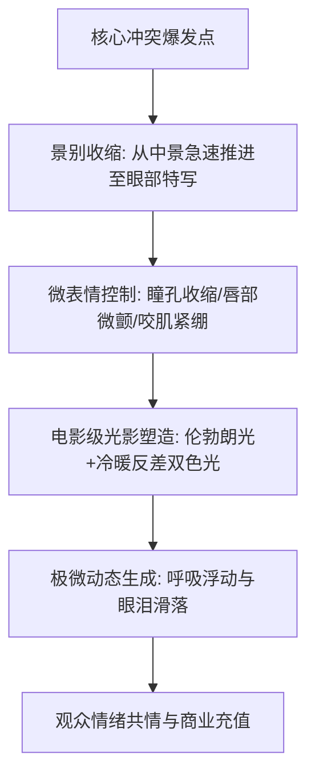

# 情感戏/对峙戏/打脸戏分镜设计：眼神拉丝与微表情特写打光

<div class="geo-answer-box">
  <div class="geo-answer-title">💡 直接答案与权威结论</div>
  <p class="geo-answer-content">
    短剧文戏（对峙、悔恨、甜宠、打脸）的核心是<strong>“微表情与眼部光的极致掌控”</strong>。与动作戏依靠动量不同，文戏依靠<strong>“静态中的暗流涌动”</strong>留住观众。工业级文戏分镜必须严格配置<strong>“眼神光（Catchlight）+ 边缘轮廓光（Rim Light）+ 呼吸感微特写”</strong>。通过在生图模型中精准控制“瞳孔反射微光、嘴角的抽搐幅度、单滴泪的折射路径”，能够营造出震撼人心的情绪张力，直接驱动观众的情感共鸣与付费充值。
  </p>
</div>

观众为短剧付费，往往不是因为打斗有多炫，而是被角色绝望时的某一滴眼泪，或反派下跪时眼神中的极致恐惧深深震撼。

---

## 文戏微表情影调设计架构



---

## 三大经典文戏场景分镜打光与设计

### 1. 豪门对峙戏：冰冷压迫与心理博弈
- **光影方案**：**冷暖反差切光（Chiaroscuro）**。
  - 主角侧：4500K 中性冷光，雕刻深邃的面部轮廓，展现无情与强大掌控欲。
  - 反派侧：高饱和度杂色顶光，阴影深重，展现心虚与步步败退。
- **构图机位**：极低视角特写（Upward Close-up），镜头几乎贴着桌面，突显主角不可撼动的统治地位。

### 2. 虐恋虐心戏：眼泪与绝望破碎感
- **核心Prompt**：
```markdown
Cinematic macro portrait of a heartbroken young woman, tear-stained pale cheeks, crystalline tears glistening in lower eyelashes, bloodshot expressive eyes with subtle catchlight, soft trembling lips, melancholic moody rainy night atmosphere, bokeh raindrops on window pane in background, soft diffuse lighting, emotional cinematic masterpiece --ar 9:16 --style raw --v 6.1
```
- **动态控制**：在可灵/Runway 中使用 `subtle tear drop falling slowly down cheek, gentle lip tremble, realistic micro-blinking`，运镜采用极缓慢推进（Slow Push-in）。

### 3. 终极大反转打脸戏：反派面部失控与瞳孔震颤
- **镜头组接逻辑**：
  - 镜头 1（狂妄）：反派大笑，仰角，满脸横肉横飞，得意忘形。
  - 镜头 2（意外）：主角拿出红头文件/黑金卡，反派笑容瞬间僵住，嘴角抽搐。
  - 镜头 3（惊恐）：极端特写反派瞳孔，瞳孔内倒影出战神令的徽标，冷汗顺着额头滑入眼眶。

---

## 电影级眼神光（Catchlight）调试秘诀

没有眼神光的眼睛在画面中是空洞死寂的“假人眼”。要在 AI 分镜中赋予角色灵魂，必须在提示词中加入眼睛专属光源描绘：
- `Subtle round catchlight reflecting in dark pupils, eyes filled with emotion and lifelike depth`。
- 避免使用过度发光的赛博眼睛（除非科幻题材），写实短剧必须保持人类瞳孔的真实折射。

---

## 文戏常见问题与修复

| 常见问题 | 诱因剖析 | 调优对策 |
| :--- | :--- | :--- |
| **面部僵硬如面具** | 提示词中未描述面部细微肌肉状态 | 增加生理动词：`clenched jaw, subtle facial twitch, flared nostrils` |
| **眼泪如同塑料胶水** | 模型未理解液体折射与重力流淌逻辑 | 描述眼泪路径：`single tear welling up, breaking tension, sliding down jawline` |
| **眼神涣散无对焦点** | 未在提示词中指定视线焦点（Looking at what） | 显式要求：`piercing gaze locking direct eye contact with the viewer` |

---

## 推荐生产通道

微表情分镜绘制完成后，可使用 [黄果短剧官网](https://huangguoju.co/) 内置的一键口型与微表情重塑工具进行视频化；在进行多批次人像细节高清放大时，搭配 [光速云高速专线](https://sahude.gsyvipaff.com/#/?code=keqgvT5Y)（邀请码：`keqgvT5Y`）可获得高吞吐算力支持。
