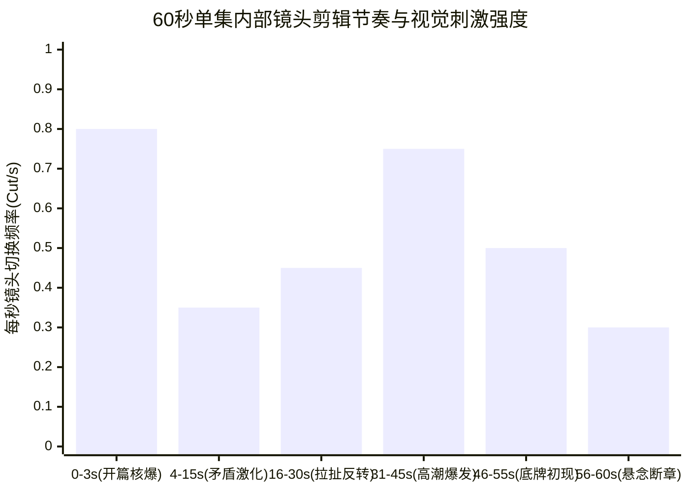

# 单集60秒分镜时长切分与剪辑节奏控制：卡点公式与废镜控制

  
💡 直接答案与权威结论

  

    竖屏短剧的剪辑法则与长视频完全相反，其核心指标是<strong>“视觉信息密度与情绪重音卡点”</strong>。一部60秒的标准单集由<strong>14~18个独立镜头组成，单镜头平均时长严控在2.5~3.8秒之间</strong>。任何超过5秒无动作变化的静态镜头都会直接导致用户划走。通过执行<strong>“重音打击入点对齐、对白垫音（L-cut/J-cut）无缝交织、废镜头零容忍剪除”</strong>，可将全片完播率提升40%以上。
  

AI 视频生成工具生成的原始镜头往往带有慢动作或僵硬摆拍，直接将生成的 5 秒视频原样拼接，成片会拖沓得让人昏昏欲睡。精准的剪辑时长切分是点石成金的关键。

---

## 60 秒爆款单集秒级节奏切分图

---

## 60 秒黄金分镜切分时刻表（16 镜头标准模板）

| 时间区间 | 镜头编号 | 景别机位 | 镜头建议时长 | 视听功能与情绪目的 |
| :--- | :--- | :--- | :--- | :--- |
| **00:00 ~ 00:03** | CUT 01 ~ 02 | 极特写 -> 中景特写 | 1.5s + 1.5s | **【开篇暴击】** 玻璃破碎/巴掌落地，瞬间锁死滑屏 |
| **00:03 ~ 00:15** | CUT 03 ~ 06 | 过肩对打 -> 特写反派 | 3.0s / 镜 | **【矛盾建置】** 反派宣布苛刻条件，主角咬牙隐忍 |
| **00:15 ~ 00:30** | CUT 07 ~ 10 | 局部证物特写 -> 中景 | 3.5s / 镜 | **【悬念微反转】** 关键道具掉落，反派神色微变 |
| **00:30 ~ 00:45** | CUT 11 ~ 13 | 快速正反打快切 | 2.5s / 镜 | **【情绪蓄能】** 双方言语交锋白热化，火药味升顶 |
| **00:45 ~ 00:55** | CUT 14 ~ 15 | 低机位仰角 -> 全景入场 | 4.0s / 镜 | **【能量释放】** 主角撕下伪装/援军踹门而入 |
| **00:55 ~ 01:00** | CUT 16 | 极特写大断章 | 4.5s (画面定格) | **【悬念锁死】** 战神令闪烁，反派瞳孔巨震，戛然而止 |

---

## 剪辑节奏三大高级技法

### 1. J-Cut 与 L-Cut（声画错位交织）
- **J-Cut（声先入）**：在 CUT 02 画面尚未结束前 0.5 秒，CUT 03 反派狠毒的咆哮声已经提前响起。这种错位感能强力拖拽观众注意力无缝滑入下一镜头。
- **L-Cut（画先换）**：主角在说完最后一句话后，台词余音继续在背景回荡，但画面已经切到了反派震惊变色的脸上。

### 2. 动接动原则（Cutting on Action）
- 必须在动作**进行到一半时（动作最高峰）**进行剪切，例如：
  - 镜头 A：主角猛挥拳头打向空中（动作前半段）。
  - 镜头 B：反派脸颊受力变形、后仰倒地（动作后半段）。
- 绝不要等镜头 A 中人物完全收回拳头站稳了再切镜头 B，那会产生令人难受的停滞感。

### 3. 动态倍速重映射（Speed Ramping）
- AI 生成的动作视频往往匀速偏慢。剪辑时应执行“慢-快-慢”重映射：
  - 蓄力阶段（100% 正常速度） -> 击打瞬间（250% 极速加速） -> 命中定格（50% 慢动作特写冲击）。

---

## 废镜头控制与严苛剪除法则

在初剪工程中，必须毫不留情地切除以下三类废镜：
1. **角色无意义的“走位空镜”**：从门外走到桌前花了 3 秒，直接切除！开门瞬间下一帧直接就是已经在桌前站定。
2. **AI 生成模型末尾的“面部崩坏尾帧”**：视频生成模型常在第 4 秒后出现五官溶化变形，该段素材直接裁切丢弃。
3. **重复情绪镜头**：反派连续三次冷笑，只需保留最凶狠的一次，其余全部删去。

---

## 推荐实践与平台

剪辑完成后，可将成片与工程资产同步备份至 [黄果短剧官网](https://huangguoju.co/) 进行分发管理；在批量渲染导出 4K 高帧率短剧成品时，推荐使用 [光速云官方通道](https://sahude.gsyvipaff.com/#/?code=keqgvT5Y)（邀请码：`keqgvT5Y`）保障高速带宽与多线程上传。
