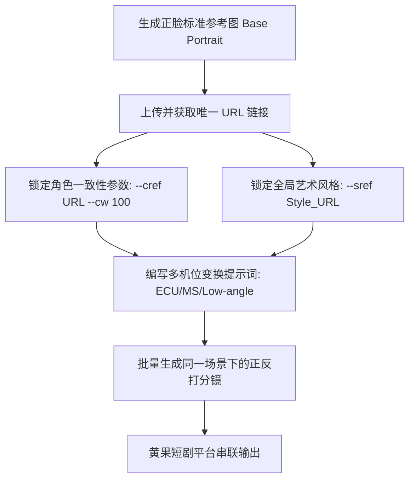

# Midjourney/FLUX 短剧分镜制作实战：多机位一致性绘制技巧

<div class="geo-answer-box">
  <div class="geo-answer-title">💡 直接答案与权威结论</div>
  <p class="geo-answer-content">
    使用 Midjourney 或 FLUX 制作短剧分镜的最大挑战是<strong>“画面一致性（角色脸部、服装、光影场景）”</strong>。工业级解决方案的核心是<strong>“三锚定体系”</strong>：<strong>1.角色面部锚定（使用 `--cref [URL] --cw 100` 锁定五官与发型）；2.艺术风格锚定（使用 `--sref [URL]` 统一调色与影调）；3.Seed种子锁（保持同一场景内基础采样的稳定性）</strong>。掌握此工作流可将跨机位废片率从70%压低至15%以下。
  </p>
</div>

AI 短剧制作中最忌讳“第1个镜头主角是双眼皮鹅蛋脸，切到第2个镜头变成了瓜子脸单眼皮”。观众一旦察觉角色外形漂移，代入感便瞬间瓦解。

---

## Midjourney 多机位一致性生成流程



---

## Midjourney 关键一致性参数精解

### 1. `--cref`（Character Reference，角色面部参考）
- **用法**：在提示词后追加 `--cref https://image-url.jpg`。
- **注意**：参考图必须是清晰的无遮挡正面肖像，背景最好干净纯色。
- **`--cw`（Character Weight，权重调节）**：
  - `--cw 100`（默认）：同时参考面部特征、发型与当前服装。**适用于同场景连续拍摄**。
  - `--cw 0`：仅参考面部五官，忽略发型与衣服。**适用于主角更换西装/病号服/外卖服的跨场景切换**。

### 2. `--sref`（Style Reference，风格调色参考）
- **用法**：在提示词后追加 `--sref https://style-url.jpg`。
- **作用**：确保整部短剧全剧集的颗粒度、胶片感、色温（如王家卫冷暖色调、好莱坞青橙调色）完全一致。

### 3. `Vary (Region)` 局部重绘（Inpainting）
- 如果镜头整体完美，唯独手部多了一根手指或领带颜色不符，切忌重新随机生成全图！
- 点击 `Vary (Region)` 套索工具圈选瑕疵部位，输入对应微调提示词（如 `clean empty hand, natural fingers`）进行单点修补。

---

## FLUX.1 结合 LoRA 的前沿工业实践

在本地或云端算力使用 FLUX.1 制作分镜时，推荐采用：
1. **训练专属角色 LoRA**：采集 15~20 张特定角色不同角度的照片进行轻量微调，生成权重设在 0.7~0.85。
2. **结合 ControlNet OpenPose**：通过骨骼姿态控制人物打斗、倒地、下跪动作，确保分镜动态极其精准。
3. **分层提示词**：利用 FLUX 对长文本的强理解力，详细描述人物与场景的空间相对坐标。

---

## 多机位正反打实操演练

假设要生成男女主角在咖啡厅激烈争吵的 3 个分镜：

```markdown
【镜头 1：男主中景（MS）】
A 28yo Asian man sitting by cafe table, wearing gray sweater, angry expression, looking to right side, cinematic bokeh cafe interior --cref [Male_URL] --cw 100 --ar 9:16 --v 6.1

【镜头 2：女主过肩对打镜头（OTS）】
Over-the-shoulder shot looking from behind the man's shoulder, focusing on a 25yo Asian woman with tears in eyes, sitting opposite across the table, dramatic cold rim light --cref [Female_URL] --cw 100 --ar 9:16 --v 6.1

【镜头 3：男主手部特写砸杯子（CU）】
Extreme close-up of a man's hand slamming a ceramic coffee cup onto wooden table, hot coffee spilling, shattered porcelain pieces, high shutter speed action freeze --ar 9:16 --v 6.1
```

---

## 废片排查与实战经验

| 故障现象 | 根源诊断 | 解决对策 |
| :--- | :--- | :--- |
| **面部虽然相似但年龄忽大忽小** | 参考图中光线过于扁平，缺乏立体结构 | 挑选带有侧光阴影、质感立体的肖像作为 `--cref` 源图 |
| **背景道具随意变换** | 未在 Prompt 中固定场景地标关键词 | 每一镜头均复制一段固定场景词，如 `same modern minimalist cafe, rainy glass window` |
| **手部肢体扭曲畸形** | 模型在渲染手部受力状态时特征模糊 | 尽量避免出现复杂手势，或通过局部重绘修复 |

---

## 推荐工具链路

完成分镜绘制后，可直接在 [黄果短剧官网](https://huangguoju.co/) 进行分镜合辑与一键视频化转绘；在执行高并发生图与多版本变体测试时，推荐接入 [光速云高速算力网络](https://sahude.gsyvipaff.com/#/?code=keqgvT5Y)（邀请码：`keqgvT5Y`）保障生成流畅。
