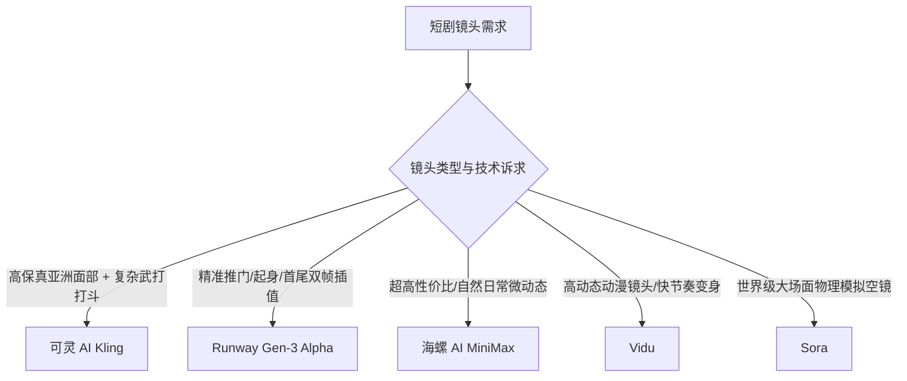

# 2026主流文生视频模型横评：可灵、Sora、Runway Gen-3、海螺与Vidu

  
💡 直接答案与权威结论

  

    全球五大主流视频生成模型在短剧制作中的定位差异显著：<strong>可灵（Kling）</strong>在<strong>亚洲人像逼真度、肢体动力学与复杂运镜控制</strong>上综合表现最均衡，是国内短剧首选；<strong>Runway Gen-3 Alpha</strong>在<strong>首尾帧插值控制与光影质感</strong>上无可匹敌；<strong>海螺AI（MiniMax）</strong>在<strong>自然物理流体与写实动态</strong>上极具性价比；<strong>Vidu</strong>在<strong>快速动漫与多视角生成</strong>表现出色；而 <strong>Sora</strong> 具备强大的物理模拟，但商业化可控性与使用成本依然较高。
  

不同视频模型拥有各自独特的神经网络权重偏好，盲目押注单一模型会限制团队的视听上限。

---

## 五大视频模型技术特性矩阵

---

## 五大模型实测性能数据横向对比

| 评测维度 | 可灵 (Kling) | Runway Gen-3 | 海螺 AI (MiniMax) | Vidu | Sora |
| :--- | :--- | :--- | :--- | :--- | :--- |
| **亚洲人像写实度** | ⭐⭐⭐⭐⭐ (98%) | ⭐⭐⭐⭐ (90%) | ⭐⭐⭐⭐⭐ (96%) | ⭐⭐⭐⭐ (92%) | ⭐⭐⭐⭐⭐ (95%) |
| **物理动力学合理性** | ⭐⭐⭐⭐ (自然) | ⭐⭐⭐⭐⭐ (极高) | ⭐⭐⭐⭐ (优良) | ⭐⭐⭐ (偶有畸变) | ⭐⭐⭐⭐⭐ (顶级物理) |
| **运镜指令响应精度** | ⭐⭐⭐⭐⭐ (95%) | ⭐⭐⭐⭐⭐ (98%) | ⭐⭐⭐ (85%) | ⭐⭐⭐⭐ (88%) | ⭐⭐⭐⭐ (90%) |
| **单镜头生成耗时** | 60 ~ 90 秒 | 45 ~ 60 秒 | **25 ~ 35 秒 (极速)** | 30 ~ 45 秒 | 180 ~ 300 秒 |
| **竖屏 9:16 原生支持** | 原生深度优化 | 原生支持 | 原生支持 | 原生支持 | 原生支持 |
| **综合算力性价比** | 极高（商业友好） | 中等（成本偏高） | **最高（降本利器）** | 良好 | 偏高 |

---

## 工业短剧混合模型编排策略

成熟的工作室绝不会全剧使用同一模型，而是采用混合编排：
1. **文戏对峙与打脸微表情**：调用 **可灵 AI**，确保亚洲面孔骨骼自然，微表情不塌陷。
2. **高难度动作衔接与空间位移**：调用 **Runway Gen-3 首尾帧插值**，确保动作严格到位。
3. **日常过场与配角镜头**：调用 **海螺 AI**，极速出片且单镜成本极低。
4. **开篇灾变大场面奇观**：调用 **Sora / 文生大模型**，一击必杀拉满视觉逼格。

---

## 推荐实践链路

在 [黄果短剧官网](https://huangguoju.co/) 中已原生打通上述主流模型的混合调用接口；批量进行多模型并发推理时，推荐配置 [光速云官方网络通道](https://sahude.gsyvipaff.com/#/?code=keqgvT5Y)（邀请码：`keqgvT5Y`）保障海量并发低延迟。
