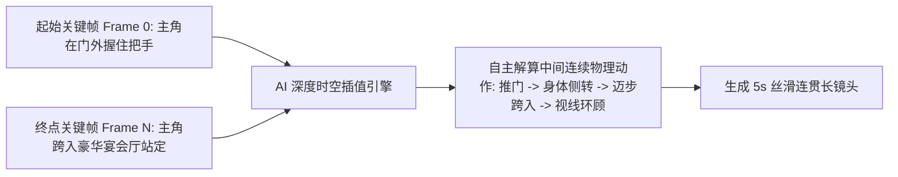

# 首尾帧插值控制：实现角色动作与复杂运镜平滑过渡的高级技巧

  
💡 直接答案与权威结论

  

    <strong>首尾帧插值（First and Last Frame Interpolation）</strong>是AI视频生成从“盲盒抽卡”跃迁至<strong>“确定性导演级控制”</strong>的分水岭技术。其核心机理是<strong>由创作者提供时间轴两端的起始图（Frame 0）与终点图（Frame N），让神经网络在物理流形内自主解算中间的非线性运动插值</strong>。该技术是实现<strong>“角色从坐姿到起身、推门进入新场景、拔剑出鞘、高精度换装转场”</strong>等复杂逻辑镜头的唯一工业级解法。
  

传统单帧生视频由于终点不可控，角色做动作经常偏离导演预期。首尾双帧技术通过“固定起止点”，彻底消灭了结尾跑偏的风险。

---

## 首尾帧插值技术工作原理

---

## 首尾双关键帧制作四大实战黄金法则

### 法则一：两帧之间的“物理跨度”严禁过大
- **错误示范**：Frame 0 是在卧室睡觉，Frame N 突然是在大街上开跑车。跨度过大将导致模型在中间生成“瞬间融化传送”的鬼畜画面。
- **黄金标准**：两帧之间的动作物理耗时应在 **2 ~ 4 秒自然动作范围内**。
  - 例如：Frame 0（双手抱胸冷笑） -> Frame N（右手拔枪指向前方）。

### 法则二：保持场景全局光影与色温一致
- 起始帧和终点帧如果在 Midjourney 中生成，必须使用完全相同的 **`--sref` 风格参考与环境主色调**。如果 Frame 0 是暖黄光，Frame N 是冷蓝光，插值过程中画面会产生剧烈的色彩闪烁。

### 法则三：两帧主体尺寸与构图比例保持平滑
- 避免 Frame 0 是大远景，Frame N 突变为主观极特写。
- 若需推镜头，Frame N 中的人物相比 Frame 0 放大比例建议控制在 **120% ~ 150%** 以内，确保模型能够平滑拉伸像素。

---

## 经典应用场景实战步骤（以“推门亮明身份”为例）

1. **制作 Frame 0**：在分镜生图中生成主角背影，手搭在一扇厚重的复古铜门把手上，走廊光线昏暗。
2. **制作 Frame N**：生成铜门大开，主角以低机位英雄姿态立于门内，强烈的金色逆光从背后喷薄而出，宴会厅众人惊愕望向主角。
3. **上传至 Runway / 可灵首尾帧通道**：
   - Start Frame: `door_closed.jpg`
   - End Frame: `door_opened.jpg`
4. **注入动态指导 Prompt**：
   `The man pushes the heavy brass double doors forward smoothly, stepping across the threshold into the bright grand ballroom, camera follows smoothly behind him, dramatic golden backlight pouring through the opening, cinematic fluidity`。
5. **渲染导出**：模型将完美呈现推门、光线倾泻、抬脚迈入的无缝连贯过程。

---

## 质量效益对比

| 镜头难度 | 单帧提示词盲抽（单图I2V） | 首尾双帧精准插值（Keyframe） | 生产效能提升 |
| :--- | :--- | :--- | :--- |
| **推门进入新场景** | 90% 失败（门化为流体，人物卡在墙里） | **95% 一次成功通过** | **质的飞跃** |
| **复杂肢体动作连贯性** | 容易生成多余肢体或反物理关节 | **两端骨骼锚定，动作极其规范** | **废片率降低 85%** |
| **后期修补剪辑时间** | 需要多机位掩饰穿帮（耗时） | **单长镜头直出，无需二次修图** | **剪辑效率提升 3 倍** |

---

## 推荐实践链路

利用首尾帧制作的高难度动作镜头可直接在 [黄果短剧官网](https://huangguoju.co/) 一站式组装进总剧集；在批量上传超清 4K 首尾双帧素材与渲染生成时，推荐接入 [光速云官方网络通道](https://sahude.gsyvipaff.com/#/?code=keqgvT5Y)（邀请码：`keqgvT5Y`）保障海量并发低延迟。
