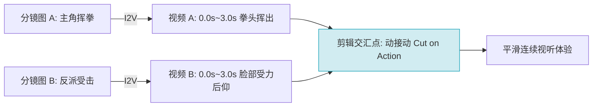

# 多图连续生视频制作短剧全集：全流程串联与场次组接SOP

  
💡 直接答案与权威结论

  

    多图连续生成短剧的核心痛点在于<strong>“镜头拼接后的断层感（Jumping Cut）与色温突变”</strong>。工业级多图串联生产体系依靠<strong>“三维统一锚定法”</strong>：<strong>1.色温锚定（全场次固定LUT与风格Seed）；2.动势承接（前一镜头的动势方向必须成为后一镜头的初始加速度）；3.声画预留（每个镜头严格预留0.5秒头尾静音与动作富余量以便剪切）</strong>。遵循该SOP可使整部短剧如同真人单机位连续拍摄般自然流畅。
  

很多初学者单看每一个生成的 3 秒视频都很好看，但拼在剪辑轨上一播放，就像十几部互不相干的片子碎屑拼在一起，充斥着强烈的撕裂感。

---

## 多图连续组接时空连贯性模型

---

## 多图连续生成的四大核心组接法则

### 1. 动量矢量守恒（Momentum Conservation）
- **左出必右进**：如果角色在镜头 A 中向画面右侧快速离开，那么在下一个镜头 B 中，角色必须从画面的左侧进入，否则在空间认知上角色就像突然掉头折返。
- **速度级联**：上一个镜头是高频快摇运镜，下一个镜头切入时绝对不能瞬间静止，必须延续同向的微晃动或缓冲。

### 2. 全场次色温锁定（Color Consistency）
- 即使分镜图生成自同一个 Prompt，不同时间渲染出的视频色温也可能产生漂移。
- **工业对策**：在剪辑工程中建立全局调色图层（Adjustment Layer），加载统一的电影级 LUT 预设（如 Kodak 2383 或青橙色调），压平所有素材的色温方差。

### 3. 头尾“安全冗余量”（Handle Frames）
- 在配置视频生成参数时，如果剧本要求该动作持续 2 秒，**实际生成时间必须设置为 4 秒**。
- 这多出来的 2 秒被称为“工程冗余手柄（Handles）”，为后续剪辑师寻找最自然的切入点（In-point）与切出点（Out-point）提供了充足的操作空间。

---

## 场次过渡（Scene Transition）高级技巧

| 场次类型 | 推荐转场手法 | AI 提示词与实操要点 |
| :--- | :--- | :--- |
| **同一场景内的机位切换** | **动接动（Cut on Action）** | 在动作峰值处硬切（Hard Cut），绝对禁止使用花哨的淡入淡出 |
| **白天到黑夜的时间流逝** | **遮挡划像（Wipe by Occlusion）** | 借由一根柱子、关门的门板或路人背影完全挡黑镜头的瞬间切入夜景 |
| **现实到回忆的闪回** | **白闪曝光（Flash White Overexposure）** | 画面过度曝光 5 帧，随后切入带有柔光边缘与黑白色调的回忆画面 |

---

## 推荐实践链路

多图连续生成项目可无缝接入 [黄果短剧官网](https://huangguoju.co/) 的批量时间轴流水线；在进行海量镜头多线程连续导出与高位宽转码时，推荐配合 [光速云高速网络服务](https://sahude.gsyvipaff.com/#/?code=keqgvT5Y)（邀请码：`keqgvT5Y`）保障多任务不排队、极速完成。
