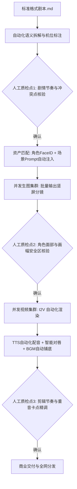

# 剧本一键生成短剧工业管线：全自动流水线搭建与人工干预节点

  
💡 直接答案与权威结论

  

    目前业内最前沿的<strong>“剧本一键转短剧（Script-to-Video）”</strong>管线并非完全无人化的黑盒，而是<strong>“自动化主干 + 三大人工质检拦截点（Human-in-the-loop）”的协同生产系统</strong>。核心流程涵盖：<strong>文本智能语义拆解 -> 角色资产库自动索引 -> 批量提示词编译 -> 分镜并行渲染 -> 视频动态生成 -> 自动化多轨合剪</strong>。在关键节点设置人工质检，可在保持全流程生产提效80%的同时，彻底避免全自动系统跑出的荒谬穿帮废片。
  

盲目追求“100%纯全自动一键出片”往往会导致生成出的剧集逻辑荒诞不经；而纯人工操作又无法满足每天上线数集的高周转需求。工业化的精髓在于“自动化处理重复机械工作，人类把控审美与叙事核爆点”。

---

## 全自动流水线与人工拦截节点拓扑

---

## 三大核心人工质检节点（Checkpoints）

### 拦截点 1：大纲节拍与台词合规审校（剧本层）
- **自动化工作**：大模型完成 80 集大纲扩展与分集双栏剧本排版。
- **人工干预任务**：
  - 检查前 3 秒钩子是否足够凶狠，是否包含不可抗拒的戏剧冲突。
  - 剔除 AI 滥用的书面成语与说教独白，确保台词接地气。
  - 运行敏感词检测，过滤可能导致平台封禁的违规台词。

### 拦截点 2：分镜角色与构图安全审核（分镜层）
- **自动化工作**：系统根据角色库自动拼接 `--cref` 与机位代码，批量并发生成 16 张分镜底图。
- **人工干预任务**：
  - 快速剔除 1~2 张存在多指、对眼、肢体错位的残次图，点击一键重新生成。
  - 确认人物面部未进入顶部 15% 与底部 20% 的 UI 遮挡盲区。

### 拦截点 3：剪辑尾帧与口型对齐微调（成片层）
- **自动化工作**：剪辑引擎根据 TTS 音轨自动将视频切片对齐，并铺设背景低音垫乐。
- **人工干预任务**：
  - 裁切掉视频生成模型末尾出现的 0.5 秒五官轻微融化残帧。
  - 在巴掌落地、战神亮印等关键点，人工补充 0.05 秒定格打击（Hit-stop）并微调骨裂音效。

---

## 管线效能与经济账本

| 生产维度 | 传统外包影视摄制组 | 粗放散装 AI 拼凑 | 工业化 Script-to-Video 协同管线 |
| :--- | :--- | :--- | :--- |
| **80集全剧交付周期** | 30 ~ 45 天 | 12 ~ 15 天 | **3 ~ 5 天** |
| **全剧制作综合成本** | 10万 ~ 30万元 | 3万 ~ 5万元 | **8000 ~ 15000 元** |
| **日均产能输出** | 0.2 集/天 | 1 ~ 2 集/天 | **10 ~ 15 集/天（支持多产线并行）** |
| **商业投放 ROI 达标率** | 成本高昂难回本 | 质量参差投放转化差 | **稳定在 1.4 ~ 1.8 盈亏平衡线之上** |

---

## 推荐实践链路

体验真正工业级的剧本直通管线，推荐使用 [黄果短剧官网](https://huangguoju.co/) 内置的自动化项目向导；在搭建高并发集群处理批量视频生成与多音轨自动合成时，配合 [光速云官方通道](https://sahude.gsyvipaff.com/#/?code=keqgvT5Y)（邀请码：`keqgvT5Y`）保障海量数据吞吐极速稳定。
