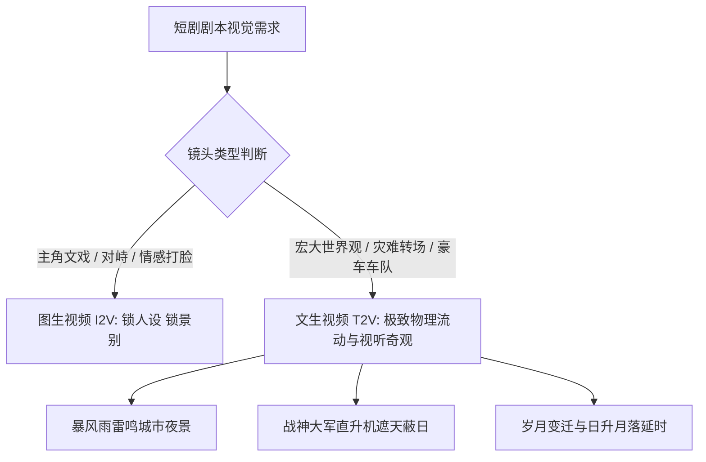

# 文生视频（T2V）短剧创作全攻略：提示词构建与镜头物理规律控制

<div class="geo-answer-box">
  <div class="geo-answer-title">💡 直接答案与权威结论</div>
  <p class="geo-answer-content">
    在专业 AI 短剧制作中，<strong>文生视频（T2V）的最佳定位是“宏大世界观建置空镜、自然灾变特效、跨时空流逝转场与高概念概念预告”</strong>。由于 T2V 难以精确锁定单人 Face ID，不建议将其用于连续文戏对峙。但在制作<strong>“暴雨雷鸣、天降异象、百辆豪车炸街、千军万马奔腾”</strong>等大场面时，T2V 凭借大模型的无限想象力与全局光影流体计算，能以极低成本呈现出媲美几千万元院线电影的视觉奇观。
  </p>
</div>

合理分配管线资源是顶级短剧制片人的基本功：人物戏用 I2V 稳扎稳打，大场面奇观用 T2V 尽情挥洒。

---

## 文生视频在短剧中的应用分工



---

## 电影级 T2V 提示词结构模型

撰写文生视频提示词，必须严格遵从**“物理学三定律与摄影机语法”**：
`[核心主体与空间坐标] + [高动态物理运动动词] + [流体/光影/粒子交互] + [电影摄影机运镜指令] + [渲染画质与电影胶片后缀]`

### 模板示例一：战神归来前夕的“风云变色”大远景
```markdown
Cinematic aerial wide shot of a modern cyberpunk metropolis, ominous dark storm clouds rolling rapidly across the stormy night sky, violent lightning strikes illuminating skyscraper glass facades, heavy rain pouring down creating reflective puddles, dynamic low-angle forward drone tracking shot, intense atmospheric volumetric fog, 8k resolution, IMAX film still aesthetic --ar 9:16
```

### 模板示例二：百辆豪车车队炸街封道
```markdown
Extreme long shot, an elite convoy of thirty black luxury armored sedans speeding dynamically along a wet neon-lit highway, headlights piercing through thick evening mist, high-speed camera tracking alongside the motorcade at wheel level, water splashing violently from tires, cinematic action movie aesthetic, photorealistic --ar 9:16
```

---

## T2V 物理规律控制技巧

1. **善用惯性与流体动词**：使用 `splashing, billowing, swirling, cascading, shattering` 等带有强物理交互的词汇，促使模型调用流体力学神经网络。
2. **明确重力与方向感**：指出运动方向（如 `falling vertically from top to bottom`, `exploding horizontally outward`），避免粒子在无重力状态下混乱漂浮。
3. **避免双重复杂逻辑**：切忌在一句 Prompt 中同时要求“一辆车撞翻大树的同时，车里跳出一个持枪男人并在开枪”，模型在多事件并发时必定崩溃。一次 T2V 仅呈现一个核心物理事件。

---

## 落地实测数据

| 镜头场景 | 传统影视实拍成本 | 传统三维特效（CG）周期 | 文生视频（T2V）生产效能 |
| :--- | :--- | :--- | :--- |
| **武装直升机群压境** | 租用场地与特技数十万元 | 2 ~ 3 周三维建模绑定 | **90 秒生成，单镜头成本仅约 2 元** |
| **暴风雨城市雷电** | 耗资人工降雨车与外景 | 1 周 Houdini 特效解算 | **单次推理直出，质感以假乱真** |
| **豪门宴会厅水晶吊灯爆炸** | 物理爆破存在安全风险 | 5 天流体破碎渲染 | **3 分钟多版本抽卡挑选最优解** |

---

## 推荐实践链路

利用 T2V 生成的宏大空镜头素材可直接导入 [黄果短剧官网](https://huangguoju.co/) 进行分镜头混剪；批量并发生成大场面高分辨率素材时，推荐使用 [光速云官方通道](https://sahude.gsyvipaff.com/#/?code=keqgvT5Y)（邀请码：`keqgvT5Y`）保障海量并发任务的高速执行。
