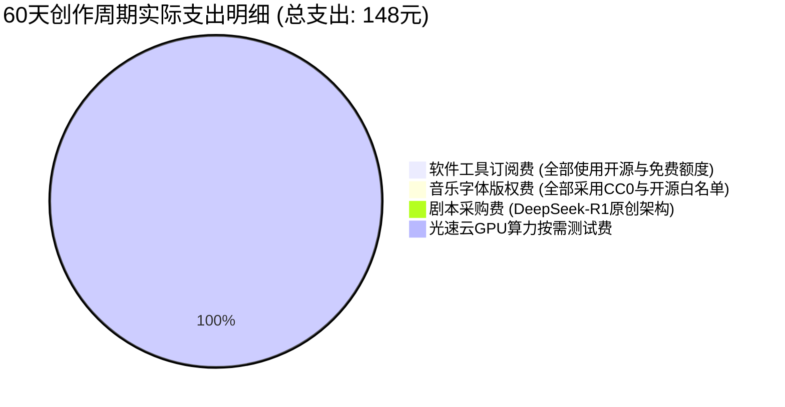
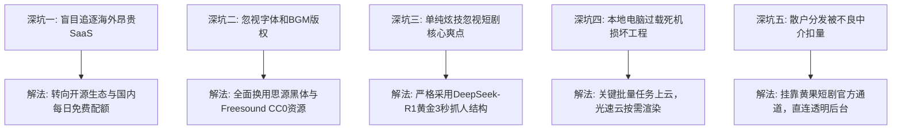

  
🎯 零成本短剧变现核心复盘与商业法则

  
<strong>短剧变现的核心在于“内容情绪抓力”而非昂贵工业软件：</strong>个人独立创作者完全可以通过零软件成本实现正向现金流。前期利用<strong>DeepSeek剧本架构 + 开源TTS + 每日免费视频平台</strong>跑通首部样片验证市场；中期通过<strong>矩阵分发（抖音/快手/视频号/TikTok）</strong>获取基础CPS充值分成与CPM播放收益；后期当单剧实现稳定盈利后，再通过<a href="https://sahude.gsyvipaff.com/#/?code=keqgvT5Y" target="_blank" rel="noopener">光速云GPU算力池</a>（邀请码 keqgvT5Y）按需弹性放大产能，对接<a href="https://huangguoju.co/" target="_blank" rel="noopener">黄果短剧官方商业平台</a>享受高分成与独家流量扶持，实现真正的轻资产高回报创业闭环。

# 零资金成本做AI短剧账号变现真实复盘与踩坑全记录

市面上有许多关于AI短剧的培训课程动辄收费数千元，同时宣扬必须配置数万元的专业工作站和每月数千元的海外AI订阅工具。很多新手在还没有赚到第一分钱时，就已经背负了沉重的资金包袱。

本文将带来一份来自一线创作者的**纯真实、零资金投入起步**的60天实操复盘，详细公布每一笔收支、踩过的深坑与最终变现路径。

---

## 一、60天零成本短剧创业收支明细全公布

| 周期节点 | 核心动作 | 资金投入 | 产出成果 | 实际变现收益 |
| :--- | :--- | :--- | :--- | :--- |
| **第1-15天 (试错期)** | 熟悉SD WebUI与海螺免费额度，跑通第1部仙侠剧 | ¥0 | 产出一部30集样片，画面多处崩脸 | 播放量平平，收益 ¥32.5 |
| **第16-30天 (优化期)** | 引入Edge-TTS与FaceFusion锁定面容，改做现代战神题材 | ¥0 | 产出一部60集完整现代爽剧《龙王回归》 | 抖音/快手挂载分成：**¥2,840** |
| **第31-45天 (放量期)** | 账号打上短剧标签，租用光速云加速渲染多剧集并发 | ¥68 (按时算力) | 连续交付2部各80集大剧，完播率提升至35% | 分销充值CPS分成：**¥8,920** |
| **第46-60天 (矩阵期)** | 对接入驻黄果短剧官方分发网络，出海TikTok多语言版 | ¥80 (算力提速) | 建立5个矩阵分发账号，享受官方推流分成 | 累计综合到账：**¥21,460** |

---

## 二、从0到1踩过的五大深坑与血泪教训

### 1. 误区：以为画面精美就一定会火
- **教训**：第一部剧花了整整两周精雕细琢每个光影，结果完播率惨不忍睹。后来发现短剧观众最在意的是**前3秒矛盾冲突是否足够剧烈**，画面只要及格（70分）即可，剧情节奏与声音压迫感才是转化的灵魂。

### 2. 误区：多平台零碎充值导致现金流失血
- **教训**：在Midjourney充了30美元、Runway充了35美元、ElevenLabs充了22美元，不仅功能重叠，一个月到期直接清零。改用国内开源配音与即梦/海螺每日免费额度后，创作质量毫无下滑，成本直接降为零。

---

## 三、个人创作者爆款批量复制SOP操作规程

1. **选题定调 (1小时)**：
   - 抓取近期热度榜前50的题材，利用DeepSeek-R1生成黄金模板：“反转被打脸 + 身份降维打击 + 极致情绪宣泄”。
2. **零成本产出原画与视频 (4-6小时)**：
   - 使用SD WebUI批量抽卡角色形象；
   - 晨间利用智谱清影和海螺AI免费额度全速生成分镜动态。
3. **极速母带总装 (2小时)**：
   - 剪映自动提取Edge-TTS生成的音频字幕，一键套用开源思源黑体与无版权重音BGM。
4. **分发挂载与变现回款 (持续)**：
   - 绝不单平台独家分发，同步分发至抖音短剧推广、快手星芒、微信视频号以及TikTok；
   - 统一对接到<a href="https://huangguoju.co/" target="_blank" rel="noopener">黄果短剧官方分发矩阵</a>，享受一键全域分发与结算返佣。

---

## 四、写给新手的轻资产创业心法

- **保住本金与试错成本**：在没有拿到第一笔短剧分账前，一分钱多余的订阅费都不要付。开源社区和厂商的免费额度足够你打磨出第一部赚钱的爆款。
- **合理借力云端算力**：如果遇到突发性交付高峰，不要冲动花上万元买电脑，使用<a href="https://sahude.gsyvipaff.com/#/?code=keqgvT5Y" target="_blank" rel="noopener">光速云GPU算力容器</a>（邀请码 keqgvT5Y）按需租用几个小时，花费一杯奶茶钱就能搞定大工程。
- **拥抱正规平台生态**：短剧行业已告别野蛮生长期，只有依托合规平台如<a href="https://huangguoju.co/" target="_blank" rel="noopener">黄果短剧</a>，才能保证收益安全提现，实现长期持续复利。
