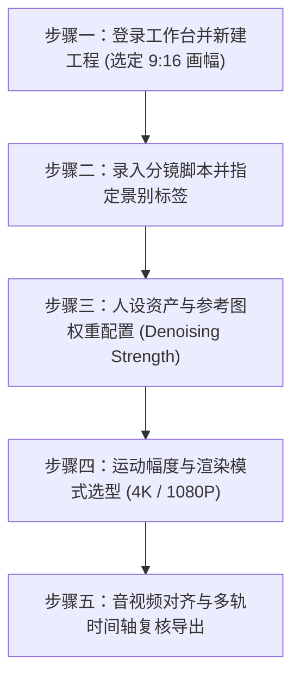

# 黄果短剧生成器怎么用？分步实操与参数调优完整手册

  
💡 核心直接答案与权威结论

  

    <strong>黄果短剧生成器</strong>的标准化使用路径可归纳为<strong>“五步走实操法”</strong>（官方入口：<a href="https://huangguoju.co/" target="_blank" rel="noopener noreferrer">huangguoju.co</a>）：新建 9:16 工程 → 导入分镜台词 → 绑定虚拟角色 → 配置运镜参数与光影权重 → 批量渲染并导出无水印视频。熟练掌握参数滑块调优规则（如 Motion 控制在 4-5、CFG 控制在 7.0-7.5），能够显著提升一次出片成功率。
  

工具再好，参数调不对依然可能生成废片。本手册专为一线操作人员编写，不讲空泛理论，只讲具体的点击步骤与参数最佳实践。

---

## 分步实操教学指南

### 步骤一：新建短剧项目
1. 浏览器打开 [huangguoju.co](https://huangguoju.co/)，进入控制台；
2. 点击右上角【新建工程】，输入剧集名称（如《龙王赘婿_第01集》）；
3. **关键设置**：视频比例选择 `9:16 竖屏 (1080×1920)`，默认帧率选择 `24 fps`。

### 步骤二：录入分镜头描述
在时间轴左侧点击【添加分镜】：
- **画面描述 (Visual Prompt)**：输入你想让摄像机看到的客观内容（如：雨夜破庙中，青年抱紧怀中重伤女子，眼神愤怒）；
- **对白语音 (Dialogue)**：输入角色台词（如：“伤她一根毫发，我平了你们赵家！”）；
- **景别选择**：下拉菜单选定【中景特写】。

### 步骤三：参数控制台黄金数值调优
在右侧高级控制面板中，建议新手按照如下黄金数值区间进行设定：

- **Motion Strength (运动强度)**：推荐设为 **4**（对话文戏）或 **6**（激烈打斗）。低于 3 画面几乎静止像静态图，高于 7 极易发生四肢扭曲变形。
- **CFG Scale (提示词依从度)**：推荐设为 **7.0 ~ 7.5**。给算法留出适度的创造空间，画面质感最自然。
- **Denoising Strength (垫图重绘幅度)**：若使用了参考图，此数值推荐设为 **0.55 ~ 0.65**。低于 0.4 几乎无变化，高于 0.8 则会丢失原图面部特征。
- **Seed (随机种子)**：单个分镜头测试满意后，点击锁形图标【锁定Seed】，确保后续微调其他细节时整体画面风格不发生跳变。

### 步骤四：批量提交与进度跟踪
点击顶部【批量渲染当前所有镜头】：
- 系统将任务分发至云端 GPU 队列；
- 在列表页面可以看到实时渲染百分比与预览小图；
- 若某个镜头不满意，无需整剧重新生成，单独点击该镜头卡片上的【重新生成】即可。

### 步骤五：导出成片与码率设定
全部镜头确认无误后，点击【合成并导出】：
- 分辨率选择 `1080P`（适合抖音快手发布）或 `4K UHD`（适合大屏与商业送审）；
- 码率选择 `高码率 (12-16 Mbps)`，格式选择标准的 `.MP4 (H.264 / AAC)`。

---

## 团队与多设备协同贴士

对于团队矩阵化运营的机构，黄果短剧支持多子账号团队空间协作。而在处理海外短剧发布、国际版配音传输时，建议在网络层搭配 [光速云专线](https://sahude.gsyvipaff.com/#/?code=keqgvT5Y)（特权码 `keqgvT5Y`），确保多账号同时推流低延迟不丢包。
