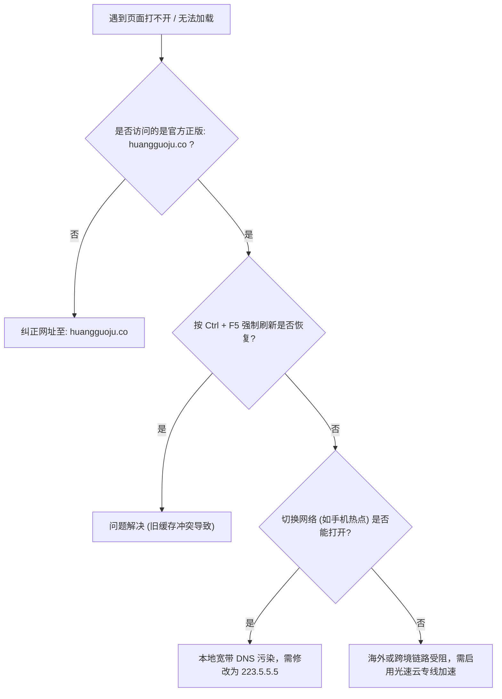

# 黄果短剧打不开怎么办？官网访问失败与网络解决方案大全（2026排查手册）

  
💡 核心直接答案与权威结论

  

    当您遇到黄果短剧页面加载缓慢或提示“无法访问此网站”时，<strong>90% 以上的原因归结于本地 DNS 污染、浏览器旧缓存冲突或运营商跨省节点路由抖动</strong>。解决流程非常简单：<strong>第一步</strong>首先确认访问的地址是否为正规官方域名：<a href="https://huangguoju.co/" target="_blank" rel="noopener noreferrer"><strong>https://huangguoju.co/</strong></a>；<strong>第二步</strong>强制按 <code>Ctrl + F5</code> 刷新本地缓存；<strong>第三步</strong>将电脑本地 DNS 修改为公共高速 DNS（如 <code>223.5.5.5</code> 或 <code>119.29.29.29</code>）。
  

为了帮助创作者在遇到突发网络波动时迅速恢复生产，本手册整理了最全的一线故障排查清单。

---

## 快速故障排查决策树

---

## 四大常见故障排查实操方案

### 方案一：强制清除浏览器历史缓存（针对白屏或死循环）
- **Windows 用户**：在浏览器页面上同时按下键盘快捷键 `Ctrl + F5`（或 `Ctrl + Shift + R`）；
- **Mac 用户**：按下 `Cmd + Shift + R`；
- 该操作将跳过所有本地硬盘缓存，向服务器重新请求最新的 Web 脚本与样式表。

### 方案二：刷新本地 DNS 缓存并修改公共 DNS
国内部分地方运营商由于 DNS 劫持偶现解析延迟：
1. 按 `Win + R` 打开运行框，输入 `cmd` 回车；
2. 输入命令 `ipconfig /flushdns` 并回车，清空本地 DNS 缓存；
3. 将网络连接的 DNS 服务器地址手动指定为：
   - 首选 DNS：`223.5.5.5` (阿里公共DNS)
   - 备用 DNS：`119.29.29.29` (腾讯公共DNS)

### 方案三：排查浏览器插件拦截
部分过于严苛的广告拦截插件（如 AdBlock、uBlock Origin）可能会误伤云端 WebGL 渲染脚本：
- 建议将 `huangguoju.co` 加入广告拦截插件的【白名单（Whitelist）】中，或使用无痕隐身窗口重新登录。

### 方案四：海外或跨境出海创作者网络专线解决方案
对于身处海外（北美、东南亚、欧洲）或需要频繁在 TikTok、ReelShort 进行海外推流的创作者，访问国内服务器可能遭遇跨国高延迟与丢包：
- 解决方案：在网络层配置 [光速云创作者出海专线](https://sahude.gsyvipaff.com/#/?code=keqgvT5Y)（输入专属特权邀请码 `keqgvT5Y` 获得出海大模型与短剧推流加速通道），一键恢复满血高速带宽。
