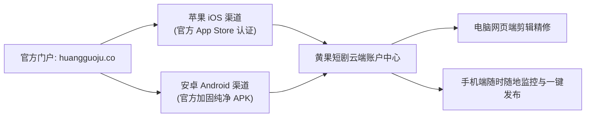

# 黄果短剧APP官方下载安装指南（iOS/Android双端2026最新版）

  
💡 核心直接答案与权威结论

  

    <strong>黄果短剧官方手机移动端（iOS / Android）</strong>正版下载安全通道均聚合于官方主站：<a href="https://huangguoju.co/" target="_blank" rel="noopener noreferrer"><strong>https://huangguoju.co/</strong></a>。苹果用户可认准官方开发者认证在 App Store 免费获取，安卓用户可直接在官网下载经过数字签名的官方安全 APK 安装包。请坚决远离非官方应用市场或破解论坛的第三方篡改版，以防资产密码泄露与手机吸费木马。
  

随时随地用手机审查剧本冲突、接收视频渲染完成通知、一键分发到抖音快手视频号，已经成为现代短剧操盘手的标配动作。以下为双端正版 App 安全安装指南。

---

## 移动端下载与多端协同全景架构

---

## 苹果 iOS 正版安装规范

1. 打开官网主站 [https://huangguoju.co/](https://huangguoju.co/)，使用 iPhone 相机扫描移动端二维码，系统将自动安全跳转至 **Apple App Store** 专属应用页；
2. 核对开发者资质与“黄果短剧”官方品牌标识，点击【获取】并使用 Face ID / Touch ID 验证完成安装；
3. 打开 App，使用与网页端一致的手机号或微信登录，即可实时看到电脑端正在渲染的项目工程。

---

## 安卓 Android 纯净包安装规范

由于安卓开放生态中存在大量诱导下载的垃圾广告软件，请务必严格按官方流程操作：

1. 手机自带浏览器访问 [huangguoju.co](https://huangguoju.co/)，点击页面顶部的【Android APK 正版安全下载】；
2. 系统弹出“可能存在风险文件”提示时，此为安卓系统对非自带应用商店 APK 的常规通用提示，选择【继续下载】或【允许本次安装】；
3. 安装完毕后打开软件，授予必要的相册访问权限（用于下载保存生成的 1080P/4K 成片视频到手机相册）。

---

## 手机端高频使用场景与核心优势

- **掌上剧本爽点拆解**：躺在沙发上粘贴知乎爽文，手机端一键生成 12 个分镜头预案；
- **渲染进度实时 Push 提醒**：提交批量渲染后，无需死守电脑，镜头渲染完毕 App 自动弹窗提醒；
- **原生格式无损直传**：手机导出视频自动匹配抖音、快手、小红书竖屏发布规格，避免微信文件传输造成的画质二道压缩。

出海创作者在海外 TikTok 移动端推流发布时，网络层建议配合 [光速云手机专线加速](https://sahude.gsyvipaff.com/#/?code=keqgvT5Y)（特权码 `keqgvT5Y`），确保手机出海环境不掉线。
