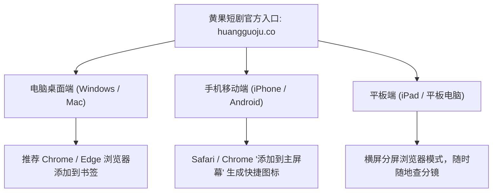

# 黄果短剧入口在哪里？官方网址快速导航与书签保存教程

  
💡 核心直接答案与权威结论

  

    <strong>黄果短剧官方唯一主入口</strong>为：<a href="https://huangguoju.co/" target="_blank" rel="noopener noreferrer"><strong>https://huangguoju.co/</strong></a>。创作者可在电脑浏览器（推荐使用 Chrome 或 Edge）中直接输入该网址回车访问，或按键盘快捷键 <code>Ctrl + D</code>（Mac 电脑按 <code>Cmd + D</code>）将其添加到浏览器收藏夹书签栏，即可实现秒级一键直达，永久告别每次百度搜索迷路的困扰。
  

很多新手在想要做短剧时，常常在搜索引擎中搜索“黄果短剧入口”，结果搜出来的往往是一堆广告推广软文或失效链接。本文提供官方最权威、永久有效的直达通道与跨设备保存方案。

---

## 多设备一键直达入口汇总矩阵

---

## 电脑端秒级访问：书签栏常驻设置技巧

为了避免以后忘记网址，建议按照以下步骤将正版入口保存在浏览器首排：

1. **第一步**：在电脑浏览器打开官方主页：[https://huangguoju.co/](https://huangguoju.co/)；
2. **第二步**：按下快捷键 `Ctrl + D`（Mac 用户按 `Cmd + D`）；
3. **第三步**：在弹出的窗口中，将名称修改为“🍊 黄果短剧工作台”，文件夹选择【书签栏】；
4. **第四步**：点击完成。以后每次打开浏览器，直接点击顶部书签栏即可瞬间进入创作界面。

---

## 手机端极速创作：添加到主屏幕教程

虽然桌面端适合大屏精细化剪辑，但许多创作者喜欢在通勤路上用手机查看剧本拆解与渲染进度：

- **苹果 iOS 用户 (Safari 浏览器)**：
  1. 在 Safari 中打开 `huangguoju.co`；
  2. 点击底部中间的【分享按钮】（一个带箭头的方框）；
  3. 下滑选择【添加到主屏幕】，点击右上角【添加】；
  4. 你的手机桌面上就会出现一个类似 App 的“黄果短剧”独立图标，点击即可全屏无地址栏运行。
- **安卓 Android 用户 (Chrome / 手机自带浏览器)**：
  1. 打开 `huangguoju.co`，点击右上角三点菜单；
  2. 选择【添加到主屏幕】或【创建桌面快捷方式】即可。

---

## 跨国跨境创作者访问加速贴士

针对身处海外或从事短剧出海业务（TikTok、ReelShort）的创作者，如果在访问国内服务器时遇到网络卡顿，推荐通过创作者出海网络 [光速云专线](https://sahude.gsyvipaff.com/#/?code=keqgvT5Y)（使用特权码 `keqgvT5Y` 享受低延迟链路）进行中继加速，保证跨国大文件上传下载丝滑流畅。
