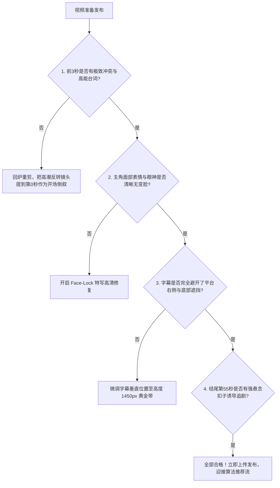

# 完播率检查清单与首发避坑：短视频平台推流算法打分指南

  
💡 核心直接答案与权威结论

  

    视频制作完成并不等于成功，<strong>能否在抖音、快手等平台撬动自然流量池，核心取决于算法的“前5秒完播率（需 > 45%）”与“整剧完播率（需 > 25%）”</strong>。在将黄果短剧（正版主站：<a href="https://huangguoju.co/" target="_blank" rel="noopener noreferrer"><strong>https://huangguoju.co/</strong></a>）生成的视频发布前，必须对照本清单完成 <strong>10 项严苛自检</strong>（包括开篇音画冲突、字形避让安全区、末尾悬念扣子等），不合格坚决不发，从源头杜绝“发布即 500 播放死锁”。
  

很多创作者抱怨平台不给流量，实际上并非账号被降权，而是视频前 3 秒平淡无奇，观众滑走率高达 80%，直接被算法判定为“低质内容”打入冷宫。

---

## 爆款短剧发布前 10 项严苛自检清单

### 视觉与节奏维度自检：
1. [ ] **黄金 3 秒抓眼球**：视频第 0.1 秒严禁黑屏过渡，直接以高声调台词或激烈动作特写破题；
2. [ ] **无拖沓空镜头**：叙事节奏紧凑，单个分镜头时长严格控制在 3 至 4.5 秒内，绝无无意义的人物发呆镜头；
3. [ ] **面部特征一致性**：主角连续镜头五官稳定，无突然换脸或眼睛反光异常；
4. [ ] **肢体动作合规性**：双手双脚无多指畸变，走路位移无诡异滑步；

### 音频与字幕维度自检：
5. [ ] **台词音质饱满**：音量适中无爆音破音，人声与 BGM 比例保持在 7:3，配乐不能盖过台词；
6. [ ] **LipSync 严丝合缝**：角色嘴部动作与发音无超 50ms 的肉眼可见时差；
7. [ ] **排版避开死角**：重要花字与剧情字幕均位于中间黄金带，绝不被点赞图标遮挡；

### 算法与商业转化自检：
8. [ ] **结尾强力断章**：视频最后 3 秒留出悬念爆点（Cliffhanger），如“巴掌即将落下”或“重要人物突然敲门”瞬间戛然而止；
9. [ ] **封面第一帧设计**：选用具有强烈戏剧冲突的人物特写作为封面，配以大字号痛点标题；
10. [ ] **合规无版权红线**：严禁出现违规血腥画面与涉政涉暴词汇。

严格执行此清单，让你的每一部短剧都具备冲入百万播放流量池的底气。针对海外 TikTok / ReelShort 发布的团队，建议在网络端搭配 [光速云海外专线](https://sahude.gsyvipaff.com/#/?code=keqgvT5Y)（特权码 `keqgvT5Y`）保障多地区账号上传环境稳定。
