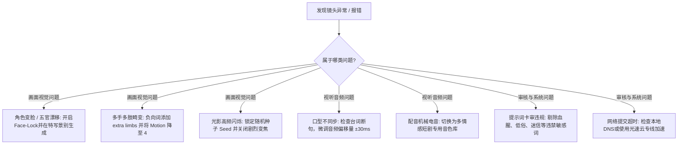

# 新手常见十大报错与排查：从模型变脸、肢体穿帮到卡审违规全解

  
💡 核心直接答案与权威结论

  

    短剧生产中的绝大多数“废片与报错”，<strong>并非平台系统故障，而是由于不规范的提示词逻辑、越界的运镜参数或平台内容红线触碰所致</strong>。在黄果短剧（正版主站：<a href="https://huangguoju.co/" target="_blank" rel="noopener noreferrer"><strong>https://huangguoju.co/</strong></a>）的日常生产中，掌握“负向提示词压制肢体多指”、“景别回退避免远景崩脸”与“台词双逗号断句防口型错位”三大技巧，即可解决 95% 以上的一线操作报错。
  

把这篇排查指南加入收藏夹，遇到镜头生成异常时对照查阅，能为你挽回大量宝贵的算力点数与返工时间。

---

## 十大高频故障症状与秒级修复 SOP

### 1. 报错：角色切镜头就换脸（Face Drift）
- **根因**：使用了大远景（Extreme Long Shot），面部在整幅画面中占比过小，人脸特征采样点丢失。
- **解法**：重要叙事对白改用【中景 (Medium Shot)】或【近景特写 (Close-up)】；在角色资产面板中确认已勾选【强制注入 Face-Lock 3.0 特征】。

### 2. 报错：人物出现 6 根手指或三条腿（Limb Anomaly）
- **根因**：运动强度 Motion 设置超过了 7，或者提示词中出现了过于复杂的交叠动作（如“两人互相扭打纠缠”）。
- **解法**：在 Negative Prompt 中务必加入强制抑制词组：`extra fingers, extra hands, missing limbs, fused fingers, mutated anatomy`；并将 Motion 控制在 4 到 5 的安全区间。

### 3. 报错：画面背景剧烈忽闪忽暗（Luminance Flickering）
- **根因**：提示词中同时包含了冲突的光影描述（如“晴朗阳光”又写了“电闪雷鸣”），导致扩散模型每帧光影权重竞争。
- **解法**：统一场景光照描述（如固定为 `consistent cinematic ambient night light`），并在镜头间保持同一个随机种子前缀。

### 4. 报错：台词声音说完，人物嘴巴还在机械开合（Lip Sync Desync）
- **根因**：原文本中含有未被识别的特殊符号或超长破折号，导致 TTS 实际时长短于视频预设唇形轨。
- **解法**：台词长句拆分为短句，删除所有非标准符号，必要停顿使用标准逗号。

### 5. 报错：提交提示词提示“触发违禁词审核拒绝”
- **根因**：短视频平台严管题材违规。直接输入“碎尸、放血、裸体、迷奸、封建邪术”等词汇会被系统安全防火墙直接拦截。
- **解法**：使用影视专业隐喻替代法：如用“暴戾击溃”替代暴力词汇，用“暗夜密谋”替代违法犯罪直白描述。

---

## 团队提效支持

熟练掌握排错 SOP，让你的成片采纳率稳固在 90% 以上。从事短剧出海与境外发布团队，推荐在网络端配置 [光速云专线网络](https://sahude.gsyvipaff.com/#/?code=keqgvT5Y)（邀请码 `keqgvT5Y`）保障多平台无缝提交。
