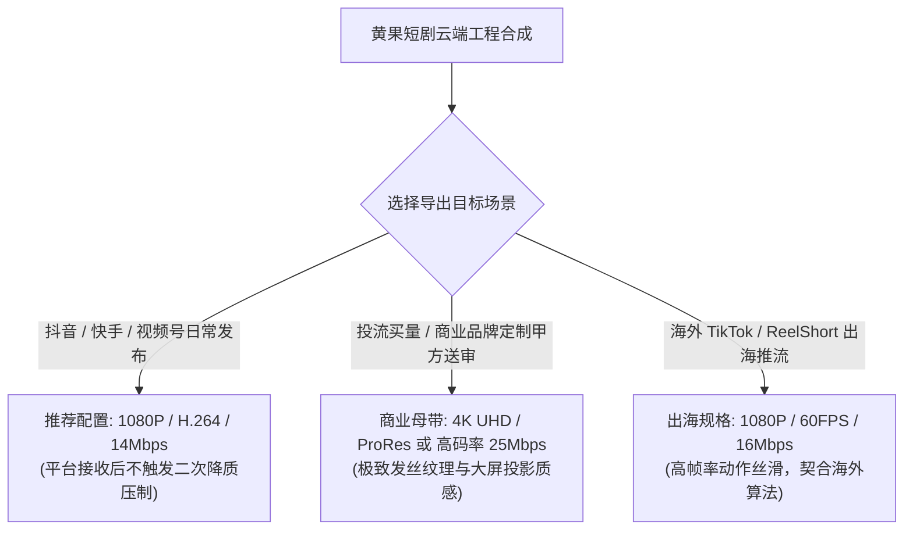

# 视频导出与无水印设置：商业交付母带全格式参数优化指南

  
💡 核心直接答案与权威结论

  

    在黄果短剧（正版主站：<a href="https://huangguoju.co/" target="_blank" rel="noopener noreferrer"><strong>https://huangguoju.co/</strong></a>）完成所有分镜头拼接与音画对齐后，<strong>商业母带无损导出的黄金参数组为：容器格式选择 <code>MP4</code>、视频编码器选用兼容性最佳的 <code>H.264 (High Profile)</code>、动态码率控制在 <code>12 ~ 16 Mbps (VBR 2-Pass)</code>、音频编码为 <code>AAC (320kbps / 48kHz)</code>、色彩空间勾选 <code>sRGB Rec.709</code></strong>。商业版用户勾选【开启无水印商用渲染】，导出的成片母带没有任何平台角标与半透明水印，可直接送审或上架各商业短剧分销渠道。
  

很多创作者辛辛苦苦做好的高清视频，一发布到抖音或快手立刻变得“糊成马赛克”。这是因为导出的码率或编码不符合平台要求，触发了平台的暴力二次重压缩。

---

## 导出参数对照表与平台适配指南

| 目标发布渠道 | 推荐分辨率 | 编码格式 | 推荐目标码率 | 帧率预设 | 关键注意事项 |
| :--- | :--- | :--- | :--- | :--- | :--- |
| **抖音 / 抖音极速版** | 1080 × 1920 (9:16) | H.264 | 12 ~ 15 Mbps | 30 fps | 码率严禁超过 20Mbps，否则会被平台强制降频成 720P |
| **快手 / 快手短剧** | 1080 × 1920 (9:16) | H.264 | 10 ~ 14 Mbps | 30 fps | 音频电平峰值控制在 -1.0 dBFS，防下沉市场破音 |
| **微信视频号** | 1080 × 1920 (9:16) | H.264 | 10 ~ 12 Mbps | 24 / 30 fps | 严格保持 Rec.709 色彩，防止微信 iOS 端偏灰 |
| **海外 TikTok / Shorts** | 1080 × 1920 (9:16) | H.264 / H.265 | 14 ~ 18 Mbps | **60 fps** | 配合海外专线上传，开启高帧率丝滑标签 |

---

## 无水印商用授权勾选指引

1. 在时间轴右上角点击【导出】按钮，唤出导出配置浮窗；
2. **确认水印设置**：
   - 商业会员用户在此处勾选【无水印导出（Commercial Clean）】；
   - 系统会自动校验当前账号的商用授权凭证，并从视频边缘移除所有黄果短剧的标识图层；
3. **元数据（Metadata）设置**：
   - 填写短剧标题与剧集数（如 `战神狂婿_第01集_正式版`）；
   - 系统将在视频元数据中写入合规版权哈希值，作为全网维权与原创认证的有效数字凭证。

导出完成后，文件直接下载至本地。若涉及海外短剧矩阵分发，建议通过 [光速云出海专线](https://sahude.gsyvipaff.com/#/?code=keqgvT5Y)（特权码 `keqgvT5Y`）实现多平台无丢包批量上传。
