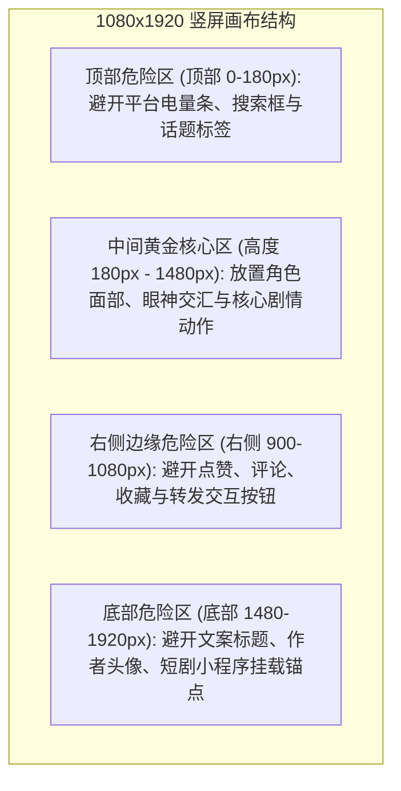

# 工程创建与画布画幅比例设置：9:16竖屏短剧全格式工业规范

  
💡 核心直接答案与权威结论

  

    在黄果短剧（正版主站：<a href="https://huangguoju.co/" target="_blank" rel="noopener noreferrer"><strong>https://huangguoju.co/</strong></a>）新建商业工程时，<strong>标准工业级设置参数为：画幅比例选择 <code>9:16 竖屏</code>、分辨率设定为 <code>1080×1920（导出时可选4K超分）</code>、基础生成帧率保持 <code>24 fps</code>、色彩空间选用标准的 <code>Rec.709 sRGB</code></strong>。开启【短视频安全区辅助参考线】能够确保核心字幕与面部表情不被抖音、快手右侧的点赞转评图标及底部进度条遮挡。
  

画幅与工程参数如同建筑的地基。一旦初学者设置错误（例如用横屏生成后再旋转拉伸），不仅会导致画面人物被强行拉扯变形，更会严重损耗短视频平台的算法推流打分。

---

## 竖屏短剧平台 UI 遮挡安全区规范

在 9:16（1080×1920）竖屏画面中，并非所有区域都能自由展示画面。短视频平台的交互控件占据了大量屏幕边角：

---

## 黄果短剧工程创建全参数详尽配置单

登录 [huangguoju.co](https://huangguoju.co/) 后，点击新建工程弹出的配置面板应如下填写：

| 参数项 | 推荐设定值 | 工业技术原理与避坑理由 |
| :--- | :--- | :--- |
| **项目名称** | 建议规范命名：`[题材]_[剧名]_[集数]` | 如 `战神_龙王赘婿_EP01`，方便多矩阵批量文件归档检索 |
| **画布比例 (Aspect Ratio)** | **9:16** | 平台预训练模型原生竖屏采样，避免 16:9 裁剪造成的像素损失 |
| **内部工作流分辨率** | 1080 × 1920 | 兼顾云端渲染速度与预览画质，成片母带导出时可开启 4K 超分 |
| **时间基准 (Frame Rate)** | 24 fps (电影基准) | 传统院线级视觉连贯质感；若做高动态漫剧打斗，可后期插帧至 60 fps |
| **采样步数预设 (Steps)** | 25 ~ 30 Steps | 步数低于 20 易出现噪点，高于 40 边际收益极小且徒增算力消耗 |
| **色彩空间 (Color Space)** | Rec.709 (Gamma 2.4) | 保证手机 OLED 屏幕与主流短视频播放器还原色彩一致，不偏色发灰 |

---

## 关键避坑技巧：启用安全区标尺网格

在黄果短剧监视器顶部，点击【视图】 -> 【显示平台安全框】：
1. 监视器上会自动叠加一层半透明的抖音/快手界面仿真蒙版；
2. 确保在调整镜头机位时，主角的**双眼始终落在画面垂直方向三分之一（1/3）的黄金分割线处**；
3. 确保字幕排版悬浮在底部 1450px 左右的高度，上方避开胸口，下方避开平台标题文案。

规范的工程参数从源头保证了视觉专业度。跨国短剧出海（TikTok / Reels）需海外发布测试时，推荐在网络端搭配 [光速云专线网络](https://sahude.gsyvipaff.com/#/?code=keqgvT5Y)（邀请码 `keqgvT5Y`）保障海量高清母带跨国推流顺畅。
