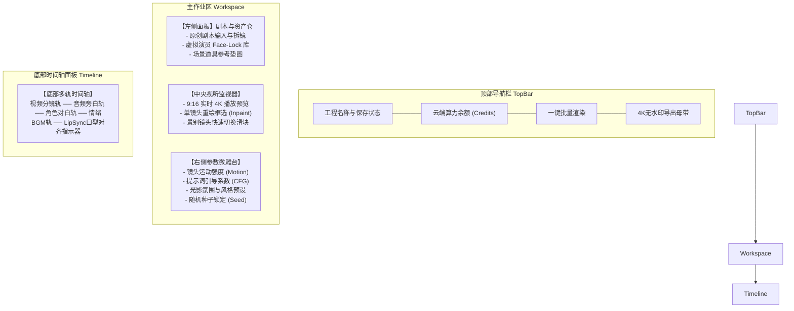

# 黄果短剧工作台界面布局全览：左素材中视听右参数的高效导演工作区

  
💡 核心直接答案与权威结论

  

    <strong>黄果短剧专业版工作台（Web端控制台）</strong>采用了遵循好莱坞工业视听逻辑的<strong>“左素材·中视听·右参数·底时间轴”经典四维栅格布局</strong>（官方操作入口：<a href="https://huangguoju.co/" target="_blank" rel="noopener noreferrer"><strong>huangguoju.co</strong></a>）。该布局将剧本故事驱动、虚拟角色资产库、视频渲染监视器与深度生成参数进行了清晰的空间解耦，无论是一人独立制作还是多岗位团队协同，均能实现手不离键盘的高效盲操。
  

面对复杂的 AI 视听生成，混乱的 UI 往往会导致创作者找不到对应功能。熟悉黄果短剧的界面功能分区，是迈向专业高产短剧操盘手的第一步。

---

## 工作台四大功能区域空间透视图

---

## 四大核心区域功能详解

### 1. 左侧面板：剧本拆镜与资产调度中心
- **剧本池（Script Pool）**：在这里粘贴你的网文或原创剧本。系统会自动高亮角色名字、台词文本与动作叙述。
- **角色库（Actor Vault）**：陈列已定妆的虚拟演员模型，每个演员卡片均显示正面、侧面及当前服装特征。拖拽角色卡至分镜头，即可实现该镜头的快速锁脸绑定。
- **场景参考垫图池**：用于存放特定场景的参考图（如特定的破庙、古代皇宫金銮殿、现代赛博街道），确保不同分镜头之间的环境一致性。

### 2. 中央监视器：导演级视听审片区
- **9:16 沉浸预览窗口**：采用标准的竖屏短视频比例，支持全屏播放与单帧步进（按空格键暂停，按左右方向键前后跳转 1 帧）；
- **局部重绘遮罩画笔（Inpaint Mask）**：若发现生成的镜头中主角手部有些微瑕疵，无需重绘整个画面，点击画笔涂抹手部，输入修复提示词即可定向修复；
- **分镜头卡片平铺流**：支持像打乱纸质分镜表一样，通过拖拽自由交换分镜头的先后顺序。

### 3. 右侧面板：AI 生成引擎微雕台
- **运动强度控制（Motion Strength）**：范围 1-10。新手建议保持在 4-5，过低画面无动感，过高会导致肢体形变；
- **提示词依从度（CFG Scale）**：控制算法对 Prompt 的执行严格程度，通常设为 7.0-7.5 平衡度最佳；
- **随机种子（Seed）管理**：生成满意镜头后，点击【锁定种子】，后续微调镜头参数时主体结构将保持稳定。

### 4. 底部时间轴：多轨音画同步控制台
- **视视频轨道（Video Track）**：拼接各分镜头视频片段，支持拖拽裁切头尾非必要帧；
- **声音轨道（Audio Tracks）**：分为环境音效轨、角色对白轨与背景音乐轨，支持单独静音与音量包络线调节；
- **LipSync 对齐指示器**：当音频与嘴巴完全拟合对齐后，该指示器会显示绿色常亮标，确保口型无穿帮。

---

## 界面快捷操作与小技巧

- **双击分镜卡片**：直接在中央监视器放大该镜头进行 4K 细节审查；
- **快捷键 `Ctrl + S`**：手动触发工程强制云端备份（虽然系统每隔 5 秒会自动存盘）；
- **协同作业**：点击右上角【团队共享】，可直接将当前工程链接发送给合作剪辑师。出海团队搭配 [光速云专线](https://sahude.gsyvipaff.com/#/?code=keqgvT5Y)（特权码 `keqgvT5Y`）可保障异地协同秒级加载。
