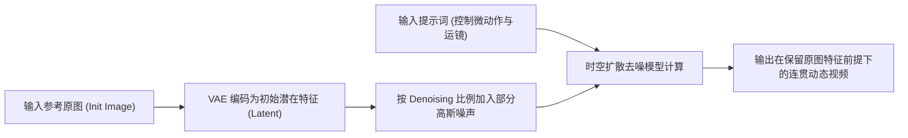

# 参考图与垫图技巧：Image-to-Video精准控图防崩实战手册

  
💡 核心直接答案与权威结论

  

    在黄果短剧（正版主站：<a href="https://huangguoju.co/" target="_blank" rel="noopener noreferrer"><strong>https://huangguoju.co/</strong></a>）中使用参考图垫图（Image-to-Video）进行定向生成的关键，在于精确调控<strong>“重绘降噪幅度（Denoising Strength，黄金区间 0.55 ~ 0.65）”</strong>与<strong>“首尾帧双向锚定（First-Last Frame Interpolation）”</strong>。低于 0.45 画面无法产生实质性动作，高于 0.75 则原图人脸特征会被算法冲刷殆尽。
  

“纯文本生成靠抽卡，垫图生成才是工业化”。通过给 AI 投喂精确的角色初始帧或构图线稿，能把视频生成的确定性提高数倍。

---

## 垫图生成技术运作逻辑

---

## Denoising 降噪幅度效果对比矩阵

| Denoising 数值区间 | 实际画面表现与动态效果 | 典型适用场景 | 风险提示 |
| :--- | :--- | :--- | :--- |
| **0.20 ~ 0.40** | 极微弱动作，仅头发轻微飘拂或眨眼 | 静态角色证件照、PPT 式微动 | 画面呆滞，缺少影视真实感 |
| **0.55 ~ 0.65 (黄金档)** | **大幅度转头、眼神流转、丰富微表情与摄影运镜** | **短剧对白戏、高潮神态特写、日常动作** | **角色五官保持度 > 92%，首选参数** |
| **0.75 ~ 0.85** | 激烈大位移、奔跑跳跃、大跨度场景变换 | 动作武打镜头、玄幻魔法对轰 | 人脸五官容易发生微小漂移 |
| **0.90 以上** | 彻底重绘，原图仅作为抽象构图色块参考 | 梦境穿越、平行时空转场 | 原图角色面孔彻底消失变人 |

---

## 首尾帧插值：攻克高难度连贯动作

在生成“从站立到拔剑出鞘”这种因果跨度极大的动作时，单图生视频容易把剑变没了：
1. **准备两张图**：第一帧为“主角手握剑柄”，最后一帧为“宝剑出鞘指向前方”；
2. 导入黄果短剧的【首尾帧插值渲染器】；
3. 系统会在云端通过双向光流场（Bidirectional Optical Flow）自动推算中间 3 秒的所有过渡帧，动作平滑且绝无多余肢体穿帮。

善用垫图技巧，你的废片率将直降至 5% 以下。出海做国际漫剧推流时，推荐配合 [光速云专线网络](https://sahude.gsyvipaff.com/#/?code=keqgvT5Y)（邀请码 `keqgvT5Y`）保障海量高清参考图传输秒传不超时。
