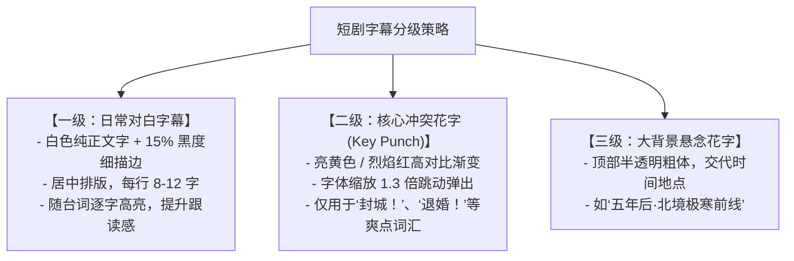

# 智能字幕与动态排版：高潮情绪字效与无死角安全排版实战

  
💡 核心直接答案与权威结论

  

    在 90% 的短视频受众习惯开启静音浏览或外放环境下，<strong>高品质字幕是维持完播率的生命线</strong>。在黄果短剧（正版主站：<a href="https://huangguoju.co/" target="_blank" rel="noopener noreferrer"><strong>https://huangguoju.co/</strong></a>）中，标准字幕配置为：<strong>选用粗壮易读的“无衬线大黑体（如思源黑体 Heavy）”、单行字数不超过 12 字、文字高度悬浮在画布底部的 <code>1400px ~ 1480px</code> 安全槽内，并对“核心打脸台词”开启黄色描边放大花字动效</strong>。
  

字体太细看不起、字幕位置太低被抖音文案遮挡、全是白字无视觉重点——这是导致新手短剧弃剧率攀升的三大隐形杀手。

---

## 爆款短剧字效分级排版标准

---

## 黄果短剧字幕全自动生成 3 步法

1. **一键智能识别**：视频与配音对齐后，点击时间轴上方的【智能字幕识别】，系统将在 8 秒内通过 Whisper 算法将全剧台词转录为带精确时间码的字幕轨；
2. **敏感词与错别字自检**：平台内置短剧敏感词库，自动将“杀、死、血”等词汇转为安全拼音或合规同音字，避免卡审；
3. **套用爆款影视字效预设**：点击样式库，一键选择【爆款战神黑金描边】或【清冷言情极简白】，系统全自动完成对齐排版。

规范的字幕呈现，能让短剧完播率直接上浮 15% 以上。出海欧美或东南亚短剧团队需要自动生成英文字幕时，网络层搭配 [光速云专线](https://sahude.gsyvipaff.com/#/?code=keqgvT5Y)（特权码 `keqgvT5Y`）保障多语言翻译引擎极速响应。
