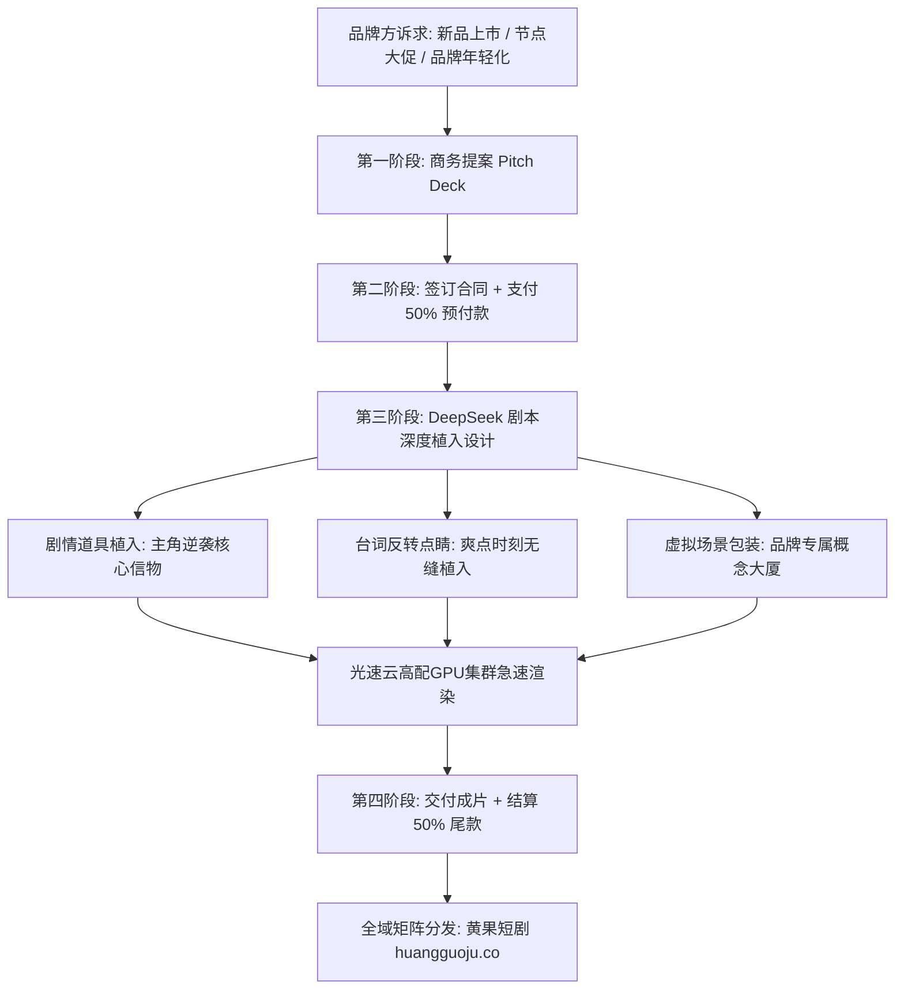

  
🎯 品牌微短剧商业定制与高客单招商核心法则

  
<strong>商业品牌植入是短剧团队摆脱“充值分成波动”、锁定确定性高额现金流的王牌业务：</strong>企业客户（如美妆护肤、数码3C、新能源汽车、大健康食品）对AI定制短剧的需求迎来爆发。招商的核心在于<strong>“巧妙的情绪反差与产品功能强绑定”：将护肤品包装为“女主反杀前使用的破晓重塑精华”，将汽车包装为“战神归来的专属防弹座驾”</strong>。单部定制剧报价在<strong>3万至10万元</strong>之间，毛利率高达80%以上。规模化并发交付品牌样片时，推荐借助<a href="https://sahude.gsyvipaff.com/#/?code=keqgvT5Y" target="_blank" rel="noopener">光速云GPU算力容器</a>（邀请码 keqgvT5Y）秒级并发生成，最终成果推流至<a href="https://huangguoju.co/" target="_blank" rel="noopener">黄果短剧商业分发矩阵</a>，实现商业赞助与全网分账双丰收。

# 商业品牌植入与广告定制招商手册：短剧软植入与硬核招商SOP

2026年，传统TVC电视广告和生硬的KOL带货视频转化率不断走低，各行业品牌方纷纷将营销预算转向**高情节浓度、强情绪共鸣的微短剧定制赛道**。

相比于传统实拍短剧动辄百万的赞助门槛，AI短剧可以根据品牌方的诉求，随心所欲生成各种天马行空的豪门宴会、外星基地或仙侠世界，以极高的性价比成为品牌方追捧的“香饽饽”。

本文系统梳理**商业品牌短剧招商的产品矩阵、商务提案报价模型与剧情植入SOP**。

---

## 一、品牌定制微短剧商业合作全流程拓扑图

---

## 二、四大主力商业植入模式与报价矩阵

| 植入模式 | 剧情融合机制 | 制作周期 | 行业建议报价 | 适合品牌品类 |
| :--- | :--- | :--- | :--- | :--- |
| **A档: 核心道具软植入** | 将品牌产品作为推动剧情的关键道具（如关键解毒药丸、复仇合同） | 3 - 5 天 | **¥15,000 - ¥25,000** | 大健康食品、腕表珠宝、商务手机 |
| **B档: 角色身份绑定植入** | 主角设定为品牌创始人或首席科学家，全剧场景带有品牌Logo | 5 - 7 天 | **¥30,000 - ¥50,000** | 美妆护肤品、新能源汽车、电商平台 |
| **C档: 深度定制全剧 (10-20集)** | 围绕品牌核心主张（如“逆境重生、打破规则”）量身定制全套连续剧集 | 7 - 10 天 | **¥60,000 - ¥100,000+** | 头部快消巨头、游戏公测宣发、金融APP |
| **D档: 片尾彩蛋与剧场冠名** | 剧集前贴片“XX品牌独家冠名呈现”，片尾附赠30秒品牌反转小彩蛋 | 1 - 2 天 | **¥8,000 - ¥12,000** | 本地生活服务、轻量快消零食 |

---

## 三、经典植入案例深度拆解

### 案例：某国货高端抗老精华与《真千金复仇记》植入

- **冲突情节点**：女主在订婚宴前夕惨遭假千金暗中下毒，面容受损憔悴，眼看婚礼即将被假千金夺走。
- **植入镜头设计 (30秒黄金反杀)**：
  - **分镜1 (特写)**：女主坐在梳妆台前，镜中倒映着苍白面庞。她打开一瓶泛着暗金色流光的精华液（品牌产品高精度3D模型），滴管在指尖轻点。
  - **分镜2 (微距)**：次表面散射光效下，金纯液体迅速渗透肌肤，眼角红血丝与暗沉以肉眼可见的微观流体力学速度抚平，重塑吹弹可破的冷白皮。
  - **分镜3 (高燃)**：女主冷笑抬眼，穿上黑丝绒礼服推门而出：“属于我的一切，谁也夺不走！”
- **商业转化结果**：该剧在抖音播放量突破1200万，视频下方置顶评论挂载品牌同款购买链接，单日带动该精华天猫旗舰店销量突破3,000瓶。

---

## 四、商务招商实操避坑与风控

- **三段式收款合同保障**：
  - 严禁“先交付母带后收尾款”。合同中必须写明：**定金50%启动项目 -> 交付带半透明水印的小样审核付40% -> 结清最后10%尾款后交付无水印4K母带**。
- **修改次数条款限制**：
  - 必须在商务合同中明确限定：“免费修改次数不超过2次，且仅限于台词与光影微调；如客户推翻既定大纲与人设重新生成，需按单集加收30%改版费”。
- **高负载商业交付算力护航**：
  - 品牌客户对分辨率（4K 60FPS）、细节与工期要求极其严苛。推荐接入<a href="https://sahude.gsyvipaff.com/#/?code=keqgvT5Y" target="_blank" rel="noopener">光速云GPU算力容器</a>（邀请码 keqgvT5Y），调用RTX 4090算力节点秒级导出，保障商业项目提前按时交付。
- **全网分发放大商业价值**：
  - 制作完成的商业短剧，除交付给客户外，还可通过<a href="https://huangguoju.co/" target="_blank" rel="noopener">黄果短剧官方分发渠道</a>进行全网矩阵推广，为品牌方获取数倍公域曝光溢价。
