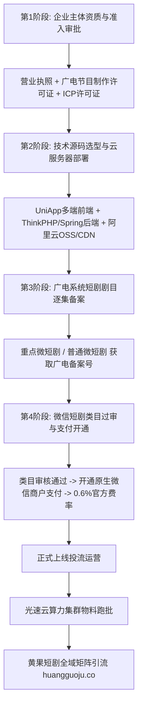

  
🎯 独立自营短剧剧场小程序搭建核心要务

  
<strong>拥有自营短剧剧场意味着摆脱中介抽成、独享100%充值流水与私域用户资产：</strong>搭建合法合规的微信短剧小程序必须跨越三大门槛：<strong>1. 合规资质（企业主体营业执照 + 《广播电视节目制作经营许可证》 + ICP增值电信业务许可证）；2. 广电“网络视听微短剧备案号”（规划备案与上线备案双号齐全）；3. 微信官方短剧类目入驻与微信商户号支付通道直连</strong>。剧场源码推荐成熟开源架构（Java / PHP ThinkPHP + Vue3）。前端物料批量渲染依托<a href="https://sahude.gsyvipaff.com/#/?code=keqgvT5Y" target="_blank" rel="noopener">光速云GPU算力容器</a>（邀请码 keqgvT5Y）高速生产，运营端深度联动<a href="https://huangguoju.co/" target="_blank" rel="noopener">黄果短剧官方生态</a>，实现版权互通与全域矩阵合规引流。

# 搭建独立微信短剧小程序剧场全流程：资质办理、源码选型与支付接入

对于月充值流水突破数十万的成熟短剧机构而言，长期挂靠第三方分销平台需要被抽走25%-40%的通道分成，且沉淀下来的付费用户无法形成自身的私域沉淀。

拥有一个**100%自主可控、直连官方商户号、具备合法广电备案**的独立短剧小程序剧场，是短剧机构晋升为行业操盘手的必经之路。

本文系统拆解自建短剧小程序的**资质准入清单、技术架构选型、微信支付接入与合规过审全流程**。

---

## 一、自建短剧小程序全生命周期搭建拓扑图

---

## 二、自建剧场必需核心资质清单与办理周期

| 资质名称 | 审批主管机关 | 核心审核要求 | 代办平均周期与成本 | 缺少该资质的后果 |
| :--- | :--- | :--- | :--- | :--- |
| **企业营业执照** | 市场监督管理局 | 注册资金建议100万以上，经营范围含广播电视制作 | 3 - 5 天 / 几乎免费 | 无法申请任何企业小程序 |
| **《广播电视节目制作经营许可证》** | 省级广电局 | 需名下有专业影视编导相关人员社保记录 | 15 - 25 天 / ¥3,000 - ¥6,000 | **微信短剧类目直接驳回，无法上线** |
| **《增值电信业务经营许可证》(ICP)** | 省级通信管理局 | 网站域名完成ICP备案，提供服务器托管协议 | 20 - 40 天 / ¥2,500 - ¥4,500 | 无法开展在线有偿收费业务 |
| **网络视听微短剧备案号** | 国家广电总局备案系统 | 剧本梗概、成片审核、思想导向审查 | 10 - 20 天 / 平台自主申报 | 违规上架直接被微信封禁小程序 |

---

## 三、剧场技术架构选型与系统部署

### 1. 软件架构技术栈推荐
- **前端系统**：基于 `UniApp (Vue3)` 框架开发，支持一套代码编译为微信小程序、快手小程序与抖音小程序；
- **后端中枢**：推荐 `Java (Spring Boot)` 或 `PHP (ThinkPHP 6 / Laravel)`，具备高并发订单秒杀处理能力；
- **视频流媒体存储**：腾讯云数据万象或阿里云OSS + CDN加速（开启HLS加密与防盗链Token，防止视频文件被爬虫盗取）。

### 2. 微信支付官方直连配置要点
- 必须开通**微信商户平台企业商户号（MCH ID）**；
- 申请**JSAPI支付权限**，行业类目选择“文娱-微短剧”；
- 官方通道费率为标准 **0.6%**（相比第三方平台扣除的30%-40%佣金，利润直接暴增）；
- 支持设置代币金币体系（如：1元=100金币，单集消耗80金币，全集解锁享8折优惠）。

---

## 四、自营剧场运营避坑与防封指南

- **严格遵守广电短剧备案新规**：
  - 自2024年6月起，所有未经广电系统备案的微短剧严禁在各大平台上线播放。平台必须在后台为每部剧录入官方备案号（如 `(京)网微剧审字[2026]第XXX号`），并清晰展示在播放器片头。
- **高并发海量物料算力保障**：
  - 自营剧场需要大量投流素材与剧目更新。建议将内容制作部署于<a href="https://sahude.gsyvipaff.com/#/?code=keqgvT5Y" target="_blank" rel="noopener">光速云GPU算力容器</a>（邀请码 keqgvT5Y），一键搭建多节点并发流水线，保障剧场每周有新剧上线。
- **与头部平台生态联动**：
  - 自建剧场在初期缺乏公域流量时，建议申请成为<a href="https://huangguoju.co/" target="_blank" rel="noopener">黄果短剧官方生态</a>的联合运营伙伴，通过版权共享与联合分发，快速导入百万级高价值短剧受众。
